# 📋 Strong Track — Audit Technique & Feuille de Route d'Implémentation

> **Document de Référence Technique & Préparation Physique**  
> **Auteur** : Lead Mobile Architect & Strength Coach  
> **Date** : Novembre 2026  
> **Cible** : Flutter 3.41+ / Dart 3.11+ / iOS & Android  

---

## 📑 Sommaire
1. [Résumé Exécutif & Grille de Notation](#1-résumé-exécutif--grille-de-notation)
2. [Audit Détaillé par Axe](#2-audit-détaillé-par-axe)
   - [Axe 1 : Architecture et Qualité du Code](#axe-1--architecture-et-qualité-du-code)
   - [Axe 2 : Performance & Gestion Mémoire](#axe-2--performance--gestion-mémoire)
   - [Axe 3 : Données, Persistance & Intégrité](#axe-3--données-persistance--intégrité)
   - [Axe 4 : Fonctionnalités Musculation & Science du Mouvement](#axe-4--fonctionnalités-musculation--science-du-mouvement)
   - [Axe 5 : UX / UI & Ergonomie en Salle](#axe-5--ux--ui--ergonomie-en-salle)
   - [Axe 6 : Sécurité & Confidentialité](#axe-6--sécurité--confidentialité)
   - [Axe 7 : Tests & Automatisation CI/CD](#axe-7--tests--automatisation-cicd)
3. [Tâches Numérotées & Spécifications de Code](#3-tâches-numérotées--spécifications-de-code)
   - [Tâche 01 (P0) : Sauvegarde & Export de Données (CSV / JSON)](#tâche-01-p0--sauvegarde--export-de-données-csv--json)
   - [Tâche 02 (P0) : Maintien de l'Écran Allumé en Séance (`WakelockPlus`)](#tâche-02-p0--maintien-de-lécran-allumé-en-séance-wakelockplus)
   - [Tâche 03 (P0) : Pipeline d'Intégration Continue (GitHub Actions)](#tâche-03-p0--pipeline-dintégration-continue-github-actions)
   - [Tâche 04 (P1) : Saisie Interactive du RPE / RIR en Séance](#tâche-04-p1--saisie-interactive-du-rpe--rir-en-séance)
   - [Tâche 05 (P1) : Retours Haptiques & Feedback Sensoriel](#tâche-05-p1--retours-haptiques--feedback-sensoriel)
   - [Tâche 06 (P1) : Ajustement Rapide des Charges (Steppers +/- 2.5 kg)](#tâche-06-p1--ajustement-rapide-des-charges-steppers--25-kg)
   - [Tâche 07 (P1) : Refactorisation Modulaire de `WorkoutSessionScreen`](#tâche-07-p1--refactorisation-modulaire-de-workoutsessionscreen)
   - [Tâche 08 (P2) : Gestion Visuelle & Temporelle des Supersets (A1/A2)](#tâche-08-p2--gestion-visuelle--temporelle-des-supersets-a1a2)
   - [Tâche 09 (P2) : Suivi Temporel du Poids Corporel & Mensurations](#tâche-09-p2--suivi-temporel-du-poids-corporel--mensurations)
   - [Tâche 10 (P2) : Importation d'Historique depuis Strong / Hevy](#tâche-10-p2--importation-dhistorique-depuis-strong--hevy)

---

## 1. Résumé Exécutif & Grille de Notation

L'application **Strong Track** dispose d'une architecture moderne et saine : Clean Architecture par fonctionnalité, persistance relationnelle 100 % hors-ligne via SQLite/Drift, gestion d'état BLoC/Cubit réactive, 25 tests automatisés au vert, et prise en charge complète du Dark/Light mode ainsi que de l'arabe RTL. 

Pour égaler et surpasser les références du marché (**Strong**, **Hevy**), l'application doit combler son absence de sauvegarde externe, optimiser l'ergonomie physique d'utilisation en salle (mains moites, écran de veille, saisie sans clavier) et enrichir la granularité athlétique (RPE/RIR direct, supersets).

| Axe d'Évaluation | Note / 10 | Statut |
| :--- | :---: | :--- |
| **1. Architecture & Qualité de code** | **8.5 / 10** | Solide, découpage Clean Architecture respecté, écran de séance à modulariser. |
| **2. Performance** | **8.0 / 10** | Débouncing disque à 280ms efficace, passage à des slivers paresseux recommandé. |
| **3. Données & Persistance** | **7.5 / 10** | Drift typé avec clés étrangères, mais criticité sur l'absence d'export/backup. |
| **4. Fonctionnalités Musculation** | **8.0 / 10** | Formules 1RM, plate calculator et timer excellents ; manque le RPE et les supersets. |
| **5. UX / UI** | **8.0 / 10** | Design sobre et fluide, à adapter aux contraintes d'entraînement lourd en salle. |
| **6. Sécurité & Confidentialité** | **9.0 / 10** | 100 % local, zéro tracking, suppression de compte RGPD intégrée. |
| **7. Tests & Déploiement** | **7.0 / 10** | 25 tests passants, mais automatisation CI/CD manquante. |

---

## 2. Audit Détaillé par Axe

### Axe 1 : Architecture et Qualité du Code
* **Organisation des dossiers** : Architecture Feature-First propre (`features/workout`, `features/exercises`, `features/history`, `features/profile`, `features/home` et `core/`).
* **Gestion d'état** : Utilisation exclusive de `flutter_bloc` (`Cubit` pour les états simples, `Bloc` pour la séance active à flux d'événements).
* **Point d'amélioration** : [`WorkoutSessionScreen`](lib/features/workout/presentation/screens/workout_session_screen.dart) cumule plus de 780 lignes. Il concentre trop de responsabilités de présentation.

### Axe 2 : Performance & Gestion Mémoire
* **Points forts** : Présence d'un `Timer` de débounce (280 ms) sur [`SetRowWidget`](lib/features/workout/presentation/widgets/set_row_widget.dart#L90-L95), empêchant les `UPDATE` SQLite intempestifs sur chaque saisie clavier.
* **Point d'amélioration** : Sur les séances très longues (ex. 8 exercices × 5 séries = 40 rangées), le `ListView` classique instancie l'ensemble des `TextEditingController` simultanément.

### Axe 3 : Données, Persistance & Intégrité
* **Points forts** :
  - Intégrité référentielle SQLite activée via `PRAGMA foreign_keys = ON;`.
  - Versionnement de schéma et migrations automatiques (`schemaVersion = 3`).
* **Défaut critique** : Aucune fonctionnalité d'export (CSV / JSON). En cas de perte de l'appareil, l'utilisateur perd son historique sans recours.

### Axe 4 : Fonctionnalités Musculation & Science du Mouvement
* **Points forts** :
  - **1RM Epley & Brzycki** : Calculateur robuste basculant intelligemment selon le rep-range.
  - **Barre Olympique** : Décomposition par côté avec barres standards (20 kg) et disques olympiques.
  - **Pyramide d'échauffement** : Montée en charge progressive sans épuisement lactique.
  - **Détection des PRs** : Suivi instantané des records historiques (charge, répétition, volume, 1RM).
* **Manques clés** :
  - La colonne `rpe` existe en base mais n'est pas modifiable pendant la séance.
  - Aucun regroupement de supersets/biséries (exercices agonistes/antagonistes).

### Axe 5 : UX / UI & Ergonomie en Salle
* **Navigation** : Back buttons systématiques, minimisation de séance sans perte d'état et support natif de `PopScope`.
* **Ergonomie en salle** : L'écran se verrouille tout seul pendant les temps de repos si `Wakelock` n'est pas activé, et la saisie par clavier système est fastidieuse avec de la magnésie ou des mains moites.

### Axe 6 : Sécurité & Confidentialité
* **Avantages majeurs** : Architecture 100 % offline-first. Aucune fuite d'identifiants, de télémétrie ou de données biométriques vers des serveurs tiers.
* **Conformité RGPD** : Présence d'une zone de danger avec suppression définitive irréversible du profil et des données.

### Axe 7 : Tests & Automatisation CI/CD
* **Tests actuels** : 25 tests unitaires, d'intégration SQLite Drift et de widgets (`test/widget_test.dart`).
* **Manque** : Absence de configuration GitHub Actions pour exécuter l'analyse et les tests sur les PRs.

---

## 3. Tâches Numérotées & Spécifications de Code

```mermaid
flowchart LR
    subgraph P0_Immediat["Niveau 1 : Immédiat (P0)"]
        T1["Tâche 01: Export CSV/JSON"]
        T2["Tâche 02: Wakelock Écran"]
        T3["Tâche 03: GitHub Actions CI"]
    end
    subgraph P1_CourtTerme["Niveau 2 : Court Terme (P1)"]
        T4["Tâche 04: Saisie RPE/RIR"]
        T5["Tâche 05: Retours Haptiques"]
        T6["Tâche 06: Steppers de Charge"]
        T7["Tâche 07: Découpage Modulaire"]
    end
    subgraph P2_LongTerme["Niveau 3 : Long Terme (P2)"]
        T8["Tâche 08: Gestion Supersets"]
        T9["Tâche 09: Poids Corporel Graph"]
        T10["Tâche 10: Import Strong/Hevy"]
    end
    P0_Immediat --> P1_CourtTerme --> P2_LongTerme
```



---

### Tâche 01 (P0) : Sauvegarde & Export de Données (CSV / JSON)
* **Objectif** : Permettre à l'utilisateur d'exporter l'intégralité de son historique d'entraînement au format CSV standard (compatible Excel / Strong / Hevy) et JSON de sauvegarde complète.
* **Fichiers concernés** :
  - `pubspec.yaml` (ajout de `share_plus` et `path_provider`)
  - `lib/features/history/domain/services/workout_export_service.dart` (nouveau)
  - `lib/features/profile/presentation/screens/profile_screen.dart` (bouton d'export)

#### Spécification du Code :
```dart
// lib/features/history/domain/services/workout_export_service.dart
import 'dart:io';
import 'package:intl/intl.dart';
import 'package:path_provider/path_provider.dart';
import 'package:share_plus/share_plus.dart';
import '../../../../core/database/app_database.dart';

class WorkoutExportService {
  final AppDatabase db;

  WorkoutExportService(this.db);

  /// Génère un fichier CSV au format d'échange international Strong/Hevy
  Future<void> exportWorkoutsToCsv() async {
    final sessions = await (db.select(db.workoutSessions)
          ..where((t) => t.completedAt.isNotNull())
          ..orderBy([(t) => OrderingTerm.desc(t.startTime)]))
        .get();

    final buffer = StringBuffer();
    // En-têtes CSV standardisés
    buffer.writeln('Date,Workout Name,Duration (min),Exercise,Set Order,Weight (kg),Reps,RPE,Completed');

    for (final session in sessions) {
      final dateStr = DateFormat('yyyy-MM-dd HH:mm').format(session.startTime);
      final durationMin = (session.durationSeconds / 60).round();

      final exercises = await (db.select(db.workoutExercises)
            ..where((t) => t.sessionId.equals(session.id))
            ..orderBy([(t) => OrderingTerm.asc(t.orderIndex)]))
          .get();

      for (final we in exercises) {
        final exerciseRecord = await (db.select(db.exercises)
              ..where((t) => t.id.equals(we.exerciseId)))
            .getSingle();

        final sets = await (db.select(db.setLogs)
              ..where((t) => t.workoutExerciseId.equals(we.id))
              ..orderBy([(t) => OrderingTerm.asc(t.setNumber)]))
            .get();

        for (final s in sets) {
          buffer.writeln(
            '"$dateStr","${session.title}",$durationMin,"${exerciseRecord.slug}",'
            '${s.setNumber},${s.weightKg ?? 0},${s.reps ?? 0},${s.rpe ?? ""},${s.isCompleted ? 1 : 0}',
          );
        }
      }
    }

    final tempDir = await getTemporaryDirectory();
    final file = File('${tempDir.path}/strong_workouts_export_${DateTime.now().millisecondsSinceEpoch}.csv');
    await file.writeAsString(buffer.toString());

    await Share.shareXFiles([XFile(file.path)], text: 'Export de mes entraînements Strong Track');
  }
}
```

---

### Tâche 02 (P0) : Maintien de l'Écran Allumé en Séance (`WakelockPlus`)
* **Objectif** : Empêcher le smartphone de se mettre en veille pendant une séance active.
* **Fichiers concernés** :
  - `pubspec.yaml`
  - `lib/features/workout/presentation/screens/workout_session_screen.dart`

#### Spécification du Code :
```yaml
# pubspec.yaml
dependencies:
  wakelock_plus: ^1.2.8
```

```dart
// lib/features/workout/presentation/screens/workout_session_screen.dart
import 'package:wakelock_plus/wakelock_plus.dart';

class WorkoutSessionScreen extends StatefulWidget {
  // ...
  @override
  State<WorkoutSessionScreen> createState() => _WorkoutSessionScreenState();
}

class _WorkoutSessionScreenState extends State<WorkoutSessionScreen> {
  @override
  void initState() {
    super.initState();
    // Maintient l'écran allumé pendant l'entraînement
    WakelockPlus.enable();
  }

  @override
  void dispose() {
    // Rétablit la veille normale à la sortie
    WakelockPlus.disable();
    super.dispose();
  }
  // ...
}
```

---

### Tâche 03 (P0) : Pipeline d'Intégration Continue (GitHub Actions)
* **Objectif** : Automatiser l'analyse statique et la suite de tests à chaque push et pull request.
* **Fichier à créer** : `.github/workflows/ci.yml`

#### Spécification du Code :
```yaml
# .github/workflows/ci.yml
name: Strong Track CI

on:
  push:
    branches: [ main, develop ]
  pull_request:
    branches: [ main ]

jobs:
  analyze_and_test:
    name: Code Quality & Test Suite
    runs-on: ubuntu-latest

    steps:
      - name: Checkout Repository
        uses: actions/checkout@v4

      - name: Set up Java Development Kit
        uses: actions/setup-java@v4
        with:
          distribution: 'zulu'
          java-version: '21'

      - name: Set up Flutter Environment
        uses: subosito/flutter-action@v2
        with:
          flutter-version: '3.41.x'
          channel: 'stable'
          cache: true

      - name: Install Dependencies
        run: flutter pub get

      - name: Verify Code Formatting
        run: dart format --output=none --set-exit-if-changed .

      - name: Static Code Analysis
        run: flutter analyze

      - name: Run Test Suite
        run: flutter test --coverage

      - name: Upload Test Coverage Report
        uses: actions/upload-artifact@v4
        with:
          name: coverage-report
          path: coverage/lcov.info
```

---

### Tâche 04 (P1) : Saisie Interactive du RPE / RIR en Séance
* **Objectif** : Donner la possibilité à l'athlète de calibrer l'effort perçu ($RPE \in [6.0, 10.0]$ ou $RIR \in [0, 4]$) sur chaque série validée.
* **Fichiers concernés** :
  - `lib/features/workout/presentation/widgets/set_row_widget.dart`

#### Spécification du Code :
```dart
// Ajout dans SetRowWidget : Chip de sélection RPE rapide
Widget _buildRpeSelector(BuildContext context) {
  final currentRpe = widget.setLog.rpe;

  return InkWell(
    onTap: () => _showRpePickerDialog(context),
    borderRadius: BorderRadius.circular(6),
    child: Container(
      padding: const EdgeInsets.symmetric(horizontal: 6, vertical: 3),
      decoration: BoxDecoration(
        color: currentRpe != null ? AppColors.ofPrimaryContainer(context) : Colors.transparent,
        borderRadius: BorderRadius.circular(6),
        border: Border.all(
          color: currentRpe != null ? AppColors.primary : AppColors.ofBorder(context),
          width: 0.8,
        ),
      ),
      child: Text(
        currentRpe != null ? '@$currentRpe' : 'RPE',
        style: TextStyle(
          fontSize: 11,
          fontWeight: FontWeight.bold,
          color: currentRpe != null ? AppColors.primary : AppColors.ofTextTertiary(context),
        ),
      ),
    ),
  );
}

void _showRpePickerDialog(BuildContext context) {
  final rpeValues = [6.0, 6.5, 7.0, 7.5, 8.0, 8.5, 9.0, 9.5, 10.0];
  showModalBottomSheet(
    context: context,
    builder: (ctx) => SafeArea(
      child: Wrap(
        children: [
          const ListTile(
            title: Text('Note d\'effort perçu (RPE / RIR)', style: TextStyle(fontWeight: FontWeight.bold)),
            subtitle: Text('RPE 10 = Échec (0 RIR) | RPE 8 = 2 répétitions en réserve'),
          ),
          Wrap(
            spacing: 8,
            runSpacing: 8,
            children: rpeValues.map((val) {
              return ChoiceChip(
                label: Text('$val (${(10 - val).toStringAsFixed(1)} RIR)'),
                selected: widget.setLog.rpe == val,
                onSelected: (selected) {
                  Navigator.pop(ctx);
                  widget.onUpdateValues(
                    widget.setLog.weightKg,
                    widget.setLog.reps,
                    selected ? val : null,
                    widget.setLog.setType,
                  );
                },
              );
            }).toList(),
          ),
        ],
      ),
    ),
  );
}
```

---

### Tâche 05 (P1) : Retours Haptiques & Feedback Sensoriel
* **Objectif** : Procurer une confirmation physique instantanée lors de la validation d'une série et un signal marquant à la fin du repos.
* **Fichiers concernés** :
  - `lib/features/workout/presentation/widgets/set_row_widget.dart`
  - `lib/features/workout/presentation/cubit/rest_timer_cubit.dart`

#### Spécification du Code :
```dart
// Dans SetRowWidget lors du clic sur le checkmark :
void _handleToggleCompleted() {
  final willBeCompleted = !widget.setLog.isCompleted;
  if (willBeCompleted) {
    // Vibration nette d'accomplissement
    HapticFeedback.mediumImpact();
  } else {
    HapticFeedback.lightImpact();
  }
  widget.onToggleCompleted(willBeCompleted);
}

// Dans RestTimerCubit lorsque remainingSeconds == 0 :
void _onTimerFinished() {
  // Triple impulsion haptique de notification de reprise
  HapticFeedback.vibrate();
}
```

---

### Tâche 06 (P1) : Ajustement Rapide des Charges (Steppers +/- 2.5 kg)
* **Objectif** : Éviter d'ouvrir le clavier système en proposant des boutons d'incréments standards de disques d'haltères.
* **Fichiers concernés** :
  - `lib/features/workout/presentation/widgets/set_row_widget.dart`

#### Spécification du Code :
```dart
// Boutons de micro-incrémentation intégrés au dialogue ou au focus du champ poids
Widget _buildQuickWeightSteppers(BuildContext context) {
  return Row(
    mainAxisAlignment: MainAxisAlignment.center,
    children: [
      _stepperButton('-2.5 kg', -2.5),
      const SizedBox(width: 8),
      _stepperButton('-1.0 kg', -1.0),
      const SizedBox(width: 8),
      _stepperButton('+1.0 kg', 1.0),
      const SizedBox(width: 8),
      _stepperButton('+2.5 kg', 2.5),
    ],
  );
}

Widget _stepperButton(String label, double delta) {
  return ActionChip(
    label: Text(label, style: const TextStyle(fontSize: 12, fontWeight: FontWeight.bold)),
    onPressed: () {
      final current = double.tryParse(_weightController.text) ?? 0.0;
      final next = (current + delta).clamp(0.0, 999.0);
      _weightController.text = next % 1 == 0 ? next.toStringAsFixed(0) : next.toStringAsFixed(1);
      _onFieldsChanged();
      HapticFeedback.selectionClick();
    },
  );
}
```

---

### Tâche 07 (P1) : Refactorisation Modulaire de `WorkoutSessionScreen`
* **Objectif** : Scinder le monolithe de 780 lignes en 3 composants distincts et testables unitairement.
* **Nouveaux fichiers à créer** :
  - `lib/features/workout/presentation/widgets/session_metrics_bar.dart`
  - `lib/features/workout/presentation/widgets/workout_exercise_card.dart`
  - `lib/features/workout/presentation/widgets/workout_session_app_bar.dart`

---

### Tâche 08 (P2) : Gestion Visuelle & Temporelle des Supersets (A1/A2)
* **Objectif** : Permettre d'associer deux ou plusieurs exercices en circuit ou bisérie antagoniste avec repos alterné.
* **Fichiers concernés** :
  - `lib/core/database/tables/workout_exercises_table.dart` (ajout colonne `supersetGroupId`)
  - `lib/features/workout/presentation/screens/workout_session_screen.dart` (connecteur visuel vertical)

#### Schéma d'implémentation :
```dart
// Ajout dans WorkoutExercisesTable :
IntColumn get supersetGroupId => integer().nullable()();

// Rendu visuel dans WorkoutExerciseCard :
// Si supersetGroupId != null, afficher une bordure gauche bleue épaisse avec pastille "A1" ou "A2"
```

---

### Tâche 09 (P2) : Suivi Temporel du Poids Corporel & Mensurations
* **Objectif** : Graphique d'évolution chronologique du poids pour valider la prise de masse ou la sèche musculaire en corrélation avec le volume d'entraînement.
* **Fichiers concernés** :
  - `lib/core/database/tables/body_measurements_table.dart` (nouveau)
  - `lib/features/profile/presentation/widgets/weight_progression_chart.dart` (nouveau)

---

### Tâche 10 (P2) : Importation d'Historique depuis Strong / Hevy
* **Objectif** : Supprimer toute friction de migration pour les nouveaux utilisateurs disposant d'un export CSV d'autres applications.
* **Fichiers concernés** :
  - `lib/features/history/domain/services/csv_import_service.dart` (nouveau)

---

## 4. Matrice de Priorisation Impact vs Effort

```mermaid
quadrantChart
    title Matrice Impact Utilisateur vs Effort de Développement
    x-axis Faible Effort --> Fort Effort
    y-axis Faible Impact --> Fort Impact
    quadrant-1 Priorité Stratégique (P1)
    quadrant-2 Victoires Rapides (P0)
    quadrant-3 Tâches Secondaires
    quadrant-4 Chantiers Majeurs (P2)
    "T01: Export CSV/JSON": [0.25, 0.90]
    "T02: Wakelock Écran": [0.15, 0.85]
    "T03: GitHub CI": [0.20, 0.80]
    "T04: Saisie RPE/RIR": [0.35, 0.88]
    "T05: Retours Haptiques": [0.15, 0.70]
    "T06: Steppers Charge": [0.30, 0.75]
    "T07: Découpage Modulaire": [0.50, 0.65]
    "T08: Supersets A1/A2": [0.65, 0.85]
    "T09: Graphique Poids": [0.60, 0.80]
    "T10: Import Strong/Hevy": [0.70, 0.78]
```

---
*Ce document sert de feuille de route opérationnelle pour les prochaines itérations de développement.*

