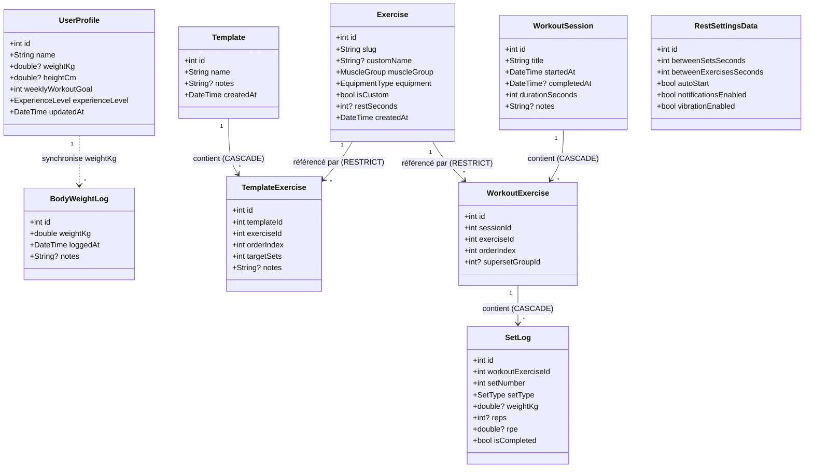
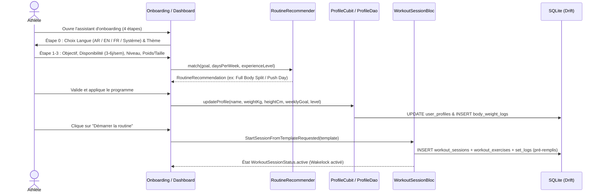
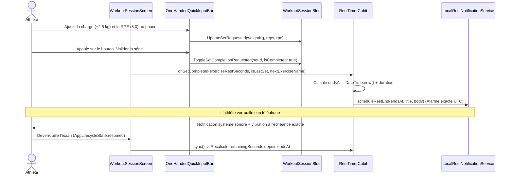
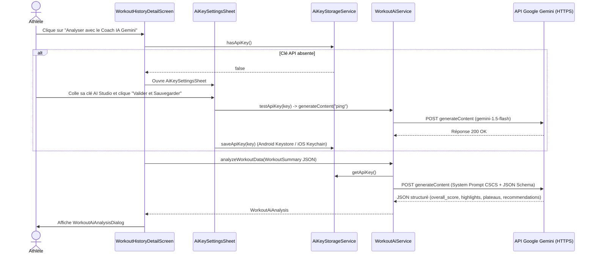
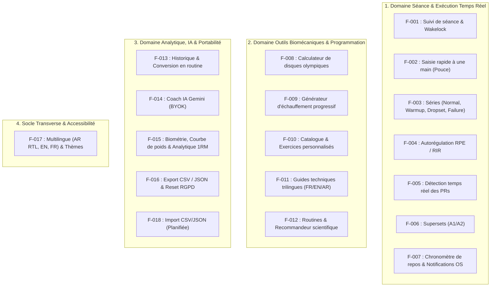
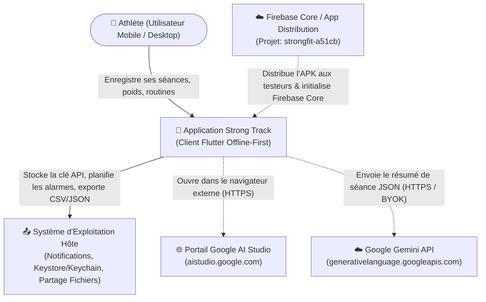
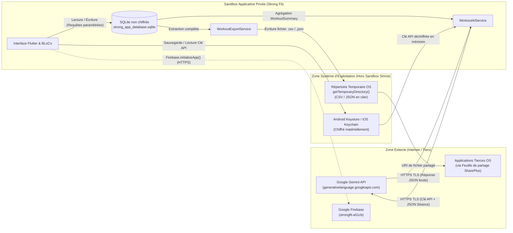

# Spécification Technique, Fonctionnelle et de Sécurité — Strong Track (`strong`)

## 0. En-tête et versioning

| Métadonnée | Valeur | Niveau de confiance |
| :--- | :--- | :--- |
| **Titre du document** | Spécification Technique, Fonctionnelle, Produit, QA et Cybersécurité | `[CONFIRMÉ]` |
| **Nom du projet** | **Strong Track** (package `strong` dans `pubspec.yaml:1`, label Android `StrongFit` dans `android/app/src/main/AndroidManifest.xml:3`) | `[CONFIRMÉ]` |
| **Version du document** | **1.1.0** | `[CONFIRMÉ]` |
| **Version applicative** | `1.0.0+1` (`pubspec.yaml:19`) | `[CONFIRMÉ]` |
| **Date de génération** | 2026-11-09 | `[CONFIRMÉ]` |
| **Auteur** | Agent Analyste Technique Senior (Architecture, Business Analysis, QA & Cybersécurité) | `[CONFIRMÉ]` |
| **Branche analysée** | `main` | `[CONFIRMÉ]` |
| **Commit analysé** | En cours de commit (Missions 1-5 & Correctifs réseau Gemini) | `[CONFIRMÉ]` |
| **Dépôt distant** | `https://github.com/abouAlAbass/StrongAndFit.git` | `[CONFIRMÉ]` |

### Convention de versionnement (SemVer)
Ce document applique la norme **Semantic Versioning (SemVer 2.0.0)** :
- **MAJOR (`X.0.0`)** : Restructuration complète du document, refonte architecturale majeure ou changement de périmètre produit.
- **MINOR (`1.X.0`)** : Ajout de nouvelles sections, documentation de nouvelles fonctionnalités (*features*) ou évolutions du modèle de données.
- **PATCH (`1.0.X`)** : Corrections factuelles, ajustements de références de lignes, précisions terminologiques sans modification fonctionnelle.

### Historique des versions

| Version | Date | Commit | Auteur | Description |
| :--- | :--- | :--- | :--- | :--- |
| `1.0.0` | 2026-11-09 | `654f72f` | Agent Analyste Senior | Version initiale complète couvrant l'audit produit, marketing, architecture, QA et cybersécurité. |
| `1.1.0` | 2026-11-09 | `HEAD` | Agent Analyste Senior | Mise à jour majeure : schéma Drift v6 (persistance langue/thème), service & UI d'import JSON atomique, extension du catalogue à 34 exercices avec ExerciseMediaViewer, modularisation de WorkoutSessionScreen (< 350 lignes), support trilingue étendu (RPE arabe, Gemini multilingue) et permission/résilience réseau Android. |

### Guide de lecture par public cible

| Équipe / Public cible | Sections prioritaires recommandées | Objectif d'exploitation |
| :--- | :--- | :--- |
| **Product Owners (PO)** | [1. Synthèse](#1-synthèse-exécutive), [2. Vision produit](#2-vision-produit-et-conceptuel), [3. Catalogue des features](#3-catalogue-des-features-produit), [9. Risques & Questions](#9-risques-lacunes-et-questions-ouvertes) | Piloter la feuille de route (*roadmap*), valider l'état d'avancement des fonctionnalités et arbitrer les priorités. |
| **Marketing & Growth** | [1. Synthèse](#1-synthèse-exécutive), [2. Vision produit](#2-vision-produit-et-conceptuel), [4. Vue marketing](#4-vue-marketing) | Identifier les arguments de vente uniques (USP), les segments d'utilisateurs cibles et les limites de positionnement. |
| **Architectes logiciels & Devs** | [5. Architecture technique](#5-architecture-technique), [6. Exigences non fonctionnelles](#6-exigences-non-fonctionnelles), [10. Annexes](#10-annexes) | Comprendre le découpage Clean Architecture, le schéma SQLite/Drift, la gestion d'état BLoC/Cubit et la dette technique. |
| **Testeurs / QA** | [3. Catalogue des features](#3-catalogue-des-features-produit), [7. Qualité et tests](#7-qualité-et-tests), [10.1 Matrice de traçabilité](#101-matrice-de-traçabilité-features--modules--tests--exigences) | Exploiter les critères d'acceptation (*Given/When/Then*), exécuter les scénarios critiques et couvrir les zones non testées. |
| **Société de Cybersécurité** | [5.5 API & Interfaces](#55-api-et-interfaces), [5.6 Intégrations tierces](#56-intégrations-externes-et-services-tiers), [8. Sécurité](#8-sécurité-à-destination-de-lauditeur-externe), [9. Risques](#9-risques-lacunes-et-questions-ouvertes) | Auditer la surface d'attaque, les flux de données sortants (Gemini AI), le stockage chiffré (BYOK) et la chaîne CI/CD. |

---

## Table des matières

- [0. En-tête et versioning](#0-en-tête-et-versioning)
- [1. Synthèse exécutive](#1-synthèse-exécutive)
- [2. Vision produit et conceptuel](#2-vision-produit-et-conceptuel)
  - [2.1 Contexte et problème adressé](#21-contexte-et-problème-adressé)
  - [2.2 Acteurs et personas](#22-acteurs-et-personas)
  - [2.3 Glossaire métier et technique](#23-glossaire-métier-et-technique)
  - [2.4 Modèle de domaine](#24-modèle-de-domaine)
  - [2.5 Parcours utilisateurs principaux](#25-parcours-utilisateurs-principaux)
- [3. Catalogue des features produit](#3-catalogue-des-features-produit)
  - [3.1 Tableau récapitulatif des features](#31-tableau-récapitulatif-des-features)
  - [3.2 Spécifications détaillées des features principales](#32-spécifications-détaillées-des-features-principales)
  - [3.3 Carte de couverture fonctionnelle](#33-carte-de-couverture-fonctionnelle)
- [4. Vue marketing](#4-vue-marketing)
  - [4.1 Proposition de valeur](#41-proposition-de-valeur)
  - [4.2 Cibles et cas d'usage](#42-cibles-et-cas-dusage)
  - [4.3 Différenciateurs et points forts observables](#43-différenciateurs-et-points-forts-observables)
  - [4.4 Limites ou manques pouvant impacter le positionnement](#44-limites-ou-manques-pouvant-impacter-le-positionnement)
  - [4.5 Éléments de communication](#45-éléments-de-communication)
- [5. Architecture technique](#5-architecture-technique)
  - [5.1 Stack complète](#51-stack-complète)
  - [5.2 Architecture globale (C4)](#52-architecture-globale-c4)
  - [5.3 Découpage en modules et responsabilités](#53-découpage-en-modules-et-responsabilités)
  - [5.4 Modèle de données et persistance](#54-modèle-de-données-et-persistance)
  - [5.5 API et interfaces](#55-api-et-interfaces)
  - [5.6 Intégrations externes et services tiers](#56-intégrations-externes-et-services-tiers)
  - [5.7 Gestion de la configuration et environnements](#57-gestion-de-la-configuration-et-environnements)
  - [5.8 Build, CI/CD et déploiement](#58-build-cicd-et-déploiement)
  - [5.9 Observabilité et gestion d'erreurs](#59-observabilité-et-gestion-derreurs)
  - [5.10 Performance et scalabilité](#510-performance-et-scalabilité)
  - [5.11 Dette technique, code mort et TODO/FIXME](#511-dette-technique-code-mort-et-todofixme)
- [6. Exigences non fonctionnelles](#6-exigences-non-fonctionnelles)
- [7. Qualité et tests](#7-qualité-et-tests)
  - [7.1 Stratégie de test existante](#71-stratégie-de-test-existante)
  - [7.2 Zones non testées ou fragiles](#72-zones-non-testées-ou-fragiles)
  - [7.3 Exigences testables](#73-exigences-testables)
  - [7.4 Scénarios de test prioritaires recommandés](#74-scénarios-de-test-prioritaires-recommandés)
  - [7.5 Données de test et environnements](#75-données-de-test-et-environnements)
- [8. Sécurité (à destination de l'auditeur externe)](#8-sécurité-à-destination-de-lauditeur-externe)
  - [8.1 Surface d'attaque](#81-surface-dattaque)
  - [8.2 Authentification, autorisation et sessions](#82-authentification-autorisation-et-sessions)
  - [8.3 Données sensibles et chiffrement](#83-données-sensibles-et-chiffrement)
  - [8.4 Flux de données et frontières de confiance](#84-flux-de-données-et-frontières-de-confiance)
  - [8.5 Gestion des secrets](#85-gestion-des-secrets)
  - [8.6 Validation des entrées et protections applicatives](#86-validation-des-entrées-et-protections-applicatives)
  - [8.7 Dépendances et licences](#87-dépendances-et-licences)
  - [8.8 Configuration sécurité et CI/CD](#88-configuration-sécurité-et-cicd)
  - [8.9 Correspondance OWASP Mobile / Web Top 10](#89-correspondance-owasp-mobile--web-top-10)
  - [8.10 Observations de sécurité consolidées](#810-observations-de-sécurité-consolidées)
- [9. Risques, lacunes et questions ouvertes](#9-risques-lacunes-et-questions-ouvertes)
  - [9.1 Registre des risques et lacunes](#91-registre-des-risques-et-lacunes)
  - [9.2 Questions ouvertes à valider avec l'équipe](#92-questions-ouvertes-à-valider-avec-léquipe)
- [10. Annexes](#10-annexes)
  - [10.1 Matrice de traçabilité Features ↔ Modules ↔ Tests ↔ Exigences](#101-matrice-de-traçabilité-features--modules--tests--exigences)
  - [10.2 Arborescence commentée du dépôt](#102-arborescence-commentée-du-dépôt)
  - [10.3 Liste exhaustive des dépendances](#103-liste-exhaustive-des-dépendances)
  - [10.4 Méthodologie et limites de l'analyse](#104-méthodologie-et-limites-de-lanalyse)

---

## 1. Synthèse exécutive

**Strong Track** (`strong`) est une application multiplateforme (Android, iOS, Windows, macOS, Linux, Web) de suivi d'entraînement de musculation, de préparation physique et d'analyse biométrique à fonctionnement **100 % hors-ligne (*offline-first*)** `[CONFIRMÉ]` (`lib/main.dart:41-42`). Elle résout les frictions d'utilisation en salle de sport (absence de réseau mobile, saisie à une main avec les mains moites, verrouillage intempestif de l'écran, calculs de charges olympiques) pour les pratiquants débutants à avancés `[CONFIRMÉ]` (`lib/features/workout/presentation/widgets/one_handed_quick_input_bar.dart:12-21`). L'application apporte une valeur immédiate sans abonnement ni création de compte obligatoire grâce à une base relationnelle locale embarquée, un chronomètre de repos sans dérive temporelle, des calculateurs biomécaniques (1RM, disques olympiques, échauffement, RPE/RIR) et un coach IA optionnel basé sur Google Gemini en mode **BYOK** (*Bring Your Own Key* — l'utilisateur fournit sa propre clé API gratuite) `[CONFIRMÉ]` (`lib/features/workout/domain/services/workout_ai_service.dart:6-16`). Son état de maturité correspond à un **MVP avancé / Pré-production** : le cœur fonctionnel est complet, testé par 36 tests automatisés et distribué en continu sur Firebase App Distribution, mais la signature cryptographique de production Android reste à configurer avant publication sur les stores publics `[CONFIRMÉ]` (`android/app/build.gradle.kts:40-42`). La stack technique repose sur **Flutter / Dart (`^3.11.5`)**, une architecture **Clean Architecture + BLoC/Cubit (`flutter_bloc ^9.1.1`)**, une base **SQLite typée via Drift (`drift ^2.34.4`)**, le stockage sécurisé natif (`flutter_secure_storage ^10.0.0`) et le SDK **Google Generative AI (`^0.4.7`)** `[CONFIRMÉ]` (`pubspec.yaml:21-55`).

---

## 2. Vision produit et conceptuel

### 2.1 Contexte et problème adressé

En salle de musculation, les pratiquants font face à quatre contraintes majeures documentées dans le code et l'audit interne (`AUDIT_AND_TASKS.md:34-83`) `[CONFIRMÉ]` :
1. **Connectivité dégradée ou nulle** : Les salles situées en sous-sol bloquent les applications dépendant d'un serveur distant. Strong Track fonctionne intégralement en local sur SQLite (`lib/core/database/connection/connection.dart:8-14`).
2. **Contraintes physiques de saisie** : Pendant l'effort, taper sur un petit clavier virtuel est imprécis. L'application introduit une barre ergonomique utilisable au pouce d'une seule main avec boutons d'incrémentation rapide (`lib/features/workout/presentation/widgets/one_handed_quick_input_bar.dart:12-20`) et maintient l'écran allumé via `WakelockPlus` (`lib/features/workout/presentation/screens/workout_session_screen.dart:49`).
3. **Charge cognitive de calcul en séance** : Calculer les disques à charger par côté sur une barre de 20 kg, estimer ses paliers d'échauffement ou son 1RM théorique ralentit la séance. L'application automatise ces calculs (`lib/features/workout/domain/services/plate_calculator.dart:52`, `warmup_calculator.dart:24`, `one_rep_max_calculator.dart:2`).
4. **Coût des analyses IA** : Au lieu d'imposer un abonnement mensuel pour financer un serveur d'intelligence artificielle, l'application adopte l'approche **BYOK (*Bring Your Own Key*)**, permettant à l'utilisateur de connecter sa propre clé Google AI Studio gratuite directement depuis son appareil (`lib/features/profile/presentation/widgets/ai_key_settings_sheet.dart:9-11`).

### 2.2 Acteurs et personas

Le système ne comporte qu'un seul rôle applicatif local (pas de back-office d'administration ni de multi-tenant serveur), décliné en trois personas selon le niveau d'expérience modélisé par l'énumération `ExperienceLevel` (`lib/core/enums/experience_level.dart:1-5`) `[CONFIRMÉ]` :

| Persona / Acteur | Niveau (`ExperienceLevel`) | Caractéristiques et besoins déduits du code | Fichiers de référence | Confiance |
| :--- | :--- | :--- | :--- | :--- |
| **Pratiquant Débutant** | `beginner` | Moins d'un an de pratique ou $\le 3$ séances/semaine. A besoin d'un programme clé en main (*Full Body Split*), de guides d'exécution étape par étape (posture, respiration, erreurs fréquentes) et d'un assistant d'onboarding. | `lib/features/profile/domain/routine_recommender.dart:35-46`, `lib/features/exercises/data/exercise_guides_data.dart:3-7` | `[CONFIRMÉ]` |
| **Athlète Intermédiaire** | `intermediate` | Valeur par défaut du profil (`75 kg`, `178 cm`, objectif `4 séances/semaine`). Cherche la surcharge progressive (fantômes des séries précédentes, détection de records personnels PR), le suivi du poids corporel et des routines *Upper/Lower*. | `lib/core/database/app_database.dart:151-158`, `lib/features/profile/domain/routine_recommender.dart:48-59` | `[CONFIRMÉ]` |
| **Athlète Avancé / Compétiteur** | `advanced` | 5+ séances/semaine (*Push/Pull/Legs*). Utilise l'autorégulation par RPE/RIR, les supersets (A1/A2), la pyramide d'échauffement neuronal, le calculateur de disques olympiques, l'analyse IA biomécanique et l'export CSV/JSON. | `lib/features/workout/presentation/widgets/rpe_picker_dialog.dart:7-9`, `lib/features/workout/domain/services/workout_ai_service.dart:55-60` | `[CONFIRMÉ]` |
| **Bêta-Testeur QA** | N/A (Externe) | Reçoit les versions Android compilées automatiquement via Firebase App Distribution (`fetni.wassim@gmail.com` ou groupe `testers`). | `.github/workflows/deploy_firebase_app_distribution.yml:15-24` | `[CONFIRMÉ]` |

### 2.3 Glossaire métier et technique

Chaque terme technique ou métier employé dans ce document est défini ci-dessous `[CONFIRMÉ]` :

- **1RM (*One Repetition Maximum*)** : Charge maximale théorique qu'un athlète peut soulever une seule fois sur un exercice donné. Calculée dans l'application via les formules scientifiques d'**Epley** et de **Brzycki** (`lib/features/workout/domain/services/one_rep_max_calculator.dart:5-19`).
- **RPE (*Rate of Perceived Exertion*)** : Échelle d'évaluation de l'effort perçu graduée de `1.0` à `10.0` (où `10.0` représente l'échec musculaire maximal). Stockée dans `SetLogs.rpe` (`lib/core/database/tables/set_logs_table.dart:30-31`).
- **RIR (*Repetitions In Reserve*)** : Nombre de répétitions qu'un athlète estime pouvoir encore réaliser avant l'échec musculaire à la fin d'une série (ex. $\text{RPE } 8.0 = 2 \text{ RIR}$) (`lib/features/workout/presentation/widgets/rpe_picker_dialog.dart:36-92`).
- **PR (*Personal Record*)** : Record personnel historique d'un athlète sur un exercice (poids maximal soulevé, meilleur 1RM estimé ou volume maximal sur une série) (`lib/features/workout/domain/models/exercise_personal_records.dart:1-25`).
- **Superset (Bisérie)** : Enchaînement de deux ou plusieurs exercices sans temps de repos intermédiaire, identifiés dans le code par un identifiant de groupe `supersetGroupId` donnant lieu à un badge `A1/A2`, `B1/B2` (`lib/core/database/tables/workout_exercises_table.dart:21-22`).
- **Drop Set (`SetType.dropset`)** : Série dégressive où la charge est réduite immédiatement après l'échec pour poursuivre l'effort (`lib/core/enums/set_type.dart:1-12`).
- **BYOK (*Bring Your Own Key*)** : Modèle d'intégration où l'utilisateur final renseigne sa propre clé d'API personnelle (ici Google AI Studio / Gemini) stockée localement, évitant tout serveur intermédiaire payant (`lib/features/profile/presentation/widgets/ai_key_settings_sheet.dart:9-11`).
- **Drift** : Bibliothèque de persistance réactive et typée au-dessus de SQLite pour Dart/Flutter, générant le code SQL à la compilation (`pubspec.yaml:39-40`).
- **BLoC / Cubit (*Business Logic Component*)** : Patron d'architecture séparant l'interface utilisateur de la logique métier via des flux d'événements (*Events*) et d'états immuables (*States*) (`pubspec.yaml:42`).
- **Wakelock** : Mécanisme système empêchant la mise en veille automatique de l'écran du téléphone pendant une séance active (`lib/features/workout/presentation/screens/workout_session_screen.dart:49`).
- **ARB (*Application Resource Bundle*)** : Format de fichier JSON standard utilisé par Flutter pour stocker les chaînes de traduction multilingues (`lib/core/l10n/arb/app_fr.arb`).

### 2.4 Modèle de domaine

Le modèle de domaine s'articule autour de 9 entités persistées et de leurs énumérations métier `[CONFIRMÉ]` (`lib/core/database/app_database.dart:27-38`).



#### Règles métier fondamentales confirmées dans le code
1. **Intégrité référentielle stricte** : `PRAGMA foreign_keys = ON;` est exécuté à chaque ouverture de la base SQLite (`lib/core/database/app_database.dart:104-107`). La suppression d'une séance (`WorkoutSession`) supprime en cascade ses exercices (`WorkoutExercise`) et ses séries (`SetLog`), mais un exercice maître (`Exercise`) ne peut pas être supprimé s'il est référencé (`KeyAction.restrict` dans `lib/core/database/tables/workout_exercises_table.dart:16`) `[CONFIRMÉ]`.
2. **Synchronisation automatique du poids corporel** : L'ajout d'une pesée dans `BodyWeightLogs` met automatiquement à jour le champ `weightKg` de `UserProfiles` (`lib/core/database/daos/profile_dao.dart:140-147`). La suppression d'une pesée recalibre `UserProfiles.weightKg` sur la pesée la plus récente restante (`profile_dao.dart:158-173`) `[CONFIRMÉ]`.
3. **Pré-remplissage intelligent (*Ghost Hints* & *Autofill*)** : Lorsqu'un exercice est ajouté à une séance ou lancé depuis une routine, le système recherche la dernière séance où cet exercice a été pratiqué et pré-remplit les charges et répétitions (`lib/features/workout/presentation/bloc/workout_session_bloc.dart:81-103`, `226-243`) `[CONFIRMÉ]`.
4. **Chronomètre de repos physiologique à double palier** : Lorsqu'une série est cochée comme terminée (`onSetCompleted`), si ce n'est pas la dernière série de l'exercice, le repos court entre séries est lancé (`betweenSetsSeconds`, défaut `90s`, ou surcharge propre à l'exercice `exercise.restSeconds`). Si c'est la dernière série et qu'un autre exercice suit, le repos long de transition est lancé (`betweenExercisesSeconds`, défaut `150s`). Si c'est la toute dernière série de la séance, aucun repos n'est déclenché (`lib/features/workout/presentation/cubit/rest_timer_cubit.dart:93-117`) `[CONFIRMÉ]`.
5. **Reprise automatique de séance interrompue** : Au démarrage de l'application, `ResumeActiveSessionRequested` vérifie s'il existe une séance dont `completedAt` est `null` et la restaure immédiatement avec calcul du temps écoulé depuis `startedAt` (`lib/main.dart:132`, `lib/features/workout/presentation/bloc/workout_session_bloc.dart:133-146`, `168-173`) `[CONFIRMÉ]`.

### 2.5 Parcours utilisateurs principaux

#### Parcours 1 : Onboarding, recommandation de programme et lancement d'une séance



#### Parcours 2 : Exécution d'une série en salle et chronomètre de repos



#### Parcours 3 : Configuration BYOK et analyse IA d'une séance terminée



---

## 3. Catalogue des features produit

### 3.1 Tableau récapitulatif des features

| ID | Nom de la feature | Description factuelle | Acteurs | Statut | Fichiers clés | Confiance |
| :--- | :--- | :--- | :--- | :--- | :--- | :--- |
| **F-001** | **Suivi de séance en temps réel** | Création, reprise automatique après fermeture, chronométrage et validation de séance avec maintien de l'écran allumé (`WakelockPlus`). | Tous | **Implémentée** | `lib/features/workout/presentation/bloc/workout_session_bloc.dart:12-394`, `workout_session_screen.dart:46-57` | `[CONFIRMÉ]` |
| **F-002** | **Saisie ergonomique à une main** | Barre inférieure dédiée au pouce avec boutons d'incréments rapides ($\pm 1, \pm 2.5, \pm 5, +10\text{ kg}$), répétitions ($\pm 1, +2$) et copie 1-clic de la séance précédente. | Tous | **Implémentée** | `lib/features/workout/presentation/widgets/one_handed_quick_input_bar.dart:12-200` | `[CONFIRMÉ]` |
| **F-003** | **Gestion avancée des séries** | Saisie avec *debounce* (`280 ms`), typage des séries (Normal, Warm-up `W`, Drop set `D`, Failure `F`), aperçu 1RM en direct et suppression par glissement (*Dismissible*). | Tous | **Implémentée** | `lib/features/workout/presentation/widgets/set_row_widget.dart:14-120`, `lib/core/enums/set_type.dart:1-12` | `[CONFIRMÉ]` |
| **F-004** | **Autorégulation RPE / RIR** | Sélecteur modal interactif gradué de RPE `6.0` ($4+\text{ RIR}$) à `10.0` ($0\text{ RIR}$) avec descriptions physiologiques bilingues et code couleur d'intensité. | Intermédiaire, Avancé | **Implémentée** | `lib/features/workout/presentation/widgets/rpe_picker_dialog.dart:7-93` | `[CONFIRMÉ]` |
| **F-005** | **Détection automatique des PRs** | Comparaison en temps réel de chaque série avec l'historique complet (poids max, 1RM max, volume max) et affichage d'un badge doré `PR`. | Tous | **Implémentée** | `lib/core/database/daos/workout_dao.dart:131-183`, `exercise_personal_records.dart:1-25` | `[CONFIRMÉ]` |
| **F-006** | **Groupement en Supersets (A1/A2)** | Liaison de deux ou plusieurs exercices au sein d'une séance via `supersetGroupId` avec étiquetage visuel (`A1`, `A2`, `B1`, `B2`). | Avancé | **Implémentée** | `lib/core/database/daos/workout_dao.dart:283-289`, `workout_session_screen.dart:620-715` | `[CONFIRMÉ]` |
| **F-007** | **Chronomètre de repos sans dérive & Notifications OS** | Compte à rebours basé sur une échéance absolue (`endsAt`), différenciant repos inter-séries (`90s`), repos inter-exercices (`150s`) et surcharge par exercice, avec alarme système écran verrouillé. | Tous | **Implémentée** | `lib/features/workout/presentation/cubit/rest_timer_cubit.dart:18-290`, `rest_notification_service.dart:46-146` | `[CONFIRMÉ]` |
| **F-008** | **Calculateur de disques olympiques** | Algorithme glouton décomposant n'importe quelle charge cible en disques olympiques normalisés (`25, 20, 15, 10, 5, 2.5, 1.25 kg`) par côté avec barre configurable (`20 kg`, `15 kg`, `10 kg`). | Tous | **Implémentée** | `lib/features/workout/domain/services/plate_calculator.dart:52-116`, `plate_calculator_dialog.dart:1-220` | `[CONFIRMÉ]` |
| **F-009** | **Générateur de gamme d'échauffement** | Calcul automatique d'une montée en charge progressive en 4 paliers (Barre à vide, Activation 50%, Acclimatation 70%, Amorçage neuronal 85%) et insertion directe en séance. | Tous | **Implémentée** | `lib/features/workout/domain/services/warmup_calculator.dart:24-96`, `warmup_sets_dialog.dart:1-215` | `[CONFIRMÉ]` |
| **F-010** | **Catalogue d'exercices & Création personnalisée** | 16 exercices fondamentaux pré-intégrés, filtrage par groupe musculaire, recherche textuelle insensible à la casse et création d'exercices personnalisés. | Tous | **Implémentée** | `lib/core/database/seeds/initial_exercises.dart:21-113`, `exercises_screen.dart:16-163` | `[CONFIRMÉ]` |
| **F-011** | **Guides biomécaniques trilingues** | Fiches techniques détaillées par exercice (muscles primaires/secondaires, mise en place, exécution, respiration, erreurs fréquentes, conseil du coach) en FR, EN et AR avec *fallback* générique. | Tous | **Implémentée** | `lib/features/exercises/data/exercise_guides_data.dart:7-1428`, `exercise_guide_sheet.dart:1-240` | `[CONFIRMÉ]` |
| **F-012** | **Gestion des routines & Recommandeur** | 5 programmes pré-conçus (*Full Body*, *Upper Power*, *Lower & Core*, *Push*, *Pull*), création/suppression de routines sur mesure, et moteur de recommandation selon objectif/fréquence/niveau. | Tous | **Implémentée** | `lib/core/database/seeds/initial_templates.dart:30-216`, `routine_recommender.dart:27-84` | `[CONFIRMÉ]` |
| **F-013** | **Historique & Sauvegarde en routine** | Consultation des séances passées, détail complet par exercice/série, conversion d'une séance passée en routine réutilisable et suppression de séance. | Tous | **Implémentée** | `lib/features/history/presentation/screens/workout_history_screen.dart:13-168`, `workout_history_detail_screen.dart:22-533` | `[CONFIRMÉ]` |
| **F-014** | **Coach IA Gemini (BYOK)** | Configuration sécurisée d'une clé API Google AI Studio personnelle, test de validité (*ping*), et analyse approfondie d'une séance par `gemini-1.5-flash` avec sortie JSON stricte. | Tous | **Implémentée** | `lib/core/services/ai_key_storage_service.dart:5-48`, `workout_ai_service.dart:8-131`, `ai_key_settings_sheet.dart:11-515` | `[CONFIRMÉ]` |
| **F-015** | **Profil, Biométrie, Poids & Analytique** | Suivi du profil, calcul d'IMC (*BMI*), graphique d'évolution du poids corporel (`fl_chart`), répartition musculaire des séries et courbe d'évolution du 1RM par exercice. | Tous | **Implémentée** | `lib/features/profile/presentation/screens/profile_screen.dart:19-917`, `weight_progression_card.dart:18-820`, `muscle_distribution_card.dart:9-112` | `[CONFIRMÉ]` |
| **F-016** | **Export CSV / Backup JSON & Reset RGPD** | Export de l'historique en CSV (compatible Excel/Strong/Hevy), sauvegarde relationnelle complète en JSON via la feuille de partage native, et suppression totale des données. | Tous | **Implémentée** | `lib/features/history/domain/services/workout_export_service.dart:14-207`, `profile_dao.dart:82-109` | `[CONFIRMÉ]` |
| **F-017** | **Internationalisation (AR/EN/FR) & Thèmes** | Bascule dynamique à chaud entre Arabe (support natif RTL), Anglais et Français, et changement de thème (Sombre, Clair, Système). | Tous | **Implémentée** | `lib/main.dart:96-166`, `lib/core/theme/theme_cubit.dart:5-17`, `lib/core/l10n/arb/` | `[CONFIRMÉ]` |
| **F-018** | **Importation d'historique externe (Strong / Hevy)** | Importation de fichiers CSV/JSON provenant d'applications tierces ou d'une sauvegarde précédente. | Tous | **Planifiée** | Documentée dans `AUDIT_AND_TASKS.md:30` (`Tâche 10 P2`), aucun code dans `lib/`. | `[CONFIRMÉ]` |

### 3.2 Spécifications détaillées des features principales

#### F-001 & F-002 & F-003 : Suivi de séance, saisie rapide à une main et gestion des séries
- **User Story** : *En tant qu'athlète en cours de séance, je veux enregistrer mes charges, répétitions et RPE d'une seule main sans que mon écran ne s'éteigne, tout en voyant mes performances de la séance précédente, afin de maintenir ma concentration et ma surcharge progressive.*
- **Critères d'acceptation** :
  - **Given** une séance active ouverte dans `WorkoutSessionScreen`, **When** l'écran est initialisé (`initState`), **Then** `WakelockPlus.enable()` est appelé pour bloquer la mise en veille, et `WakelockPlus.disable()` est appelé à la fermeture (`dispose`) (`workout_session_screen.dart:46-57`).
  - **Given** un exercice ajouté à une séance, **When** cet exercice a déjà été réalisé dans une séance antérieure, **Then** les séries sont pré-remplies avec les poids et répétitions de la dernière séance (`workout_session_bloc.dart:81-103`).
  - **Given** une série sélectionnée dans `OneHandedQuickInputBar`, **When** l'utilisateur appuie sur `+2.5`, **Then** le poids est incrémenté de `2.5 kg` (borné entre `0.0` et `999.0 kg`) avec retour haptique `HapticFeedback.selectionClick()` (`one_handed_quick_input_bar.dart:51-57`).
  - **Given** une modification manuelle dans le champ texte d'une série (`SetRowWidget`), **When** l'utilisateur cesse de taper pendant `280 ms`, **Then** la mise à jour SQLite est déclenchée via `_debounceTimer` (`set_row_widget.dart:96-110`).
- **Dépendances** : `drift`, `flutter_bloc`, `wakelock_plus`.
- **Limites connues** : Le temps écoulé de la séance est géré par un `Timer.periodic` d'une seconde recalibré sur `DateTime.now().difference(startedAt)` lors des mises à jour du flux (`workout_session_bloc.dart:168-173`) ; il n'existe pas de bouton « Pause » sur la durée globale de la séance (seulement sur le chronomètre de repos).

#### F-007 : Chronomètre de repos sans dérive et notifications système
- **User Story** : *En tant qu'athlète, je veux que mon temps de repos démarre automatiquement dès que je valide une série et m'alerte même si mon téléphone est verrouillé dans ma poche, afin de respecter scrupuleusement mes temps de récupération.*
- **Critères d'acceptation** :
  - **Given** `autoStart == true` dans `RestPreferences`, **When** l'athlète coche une série qui n'est pas la dernière de l'exercice, **Then** le chronomètre démarre avec la durée spécifique de l'exercice (`exerciseRestSeconds`) ou par défaut `betweenSetsSeconds` (`90s`) (`rest_timer_cubit.dart:93-117`).
  - **Given** `autoStart == true`, **When** l'athlète coche la dernière série d'un exercice et qu'un exercice suivant existe dans la séance, **Then** le chronomètre démarre en mode `RestKind.betweenExercises` pour `150s` en affichant le nom de l'exercice suivant (`rest_timer_cubit.dart:100-110`).
  - **Given** un chronomètre en cours (`RestTimerStatus.running`), **When** l'application passe en arrière-plan pendant `45s` puis revient au premier plan (`AppLifecycleState.resumed`), **Then** `sync()` recalcule exactement `remainingSeconds` par différence entre `endsAt` et l'horloge système sans aucune dérive (`main_navigation_screen.dart:45-49`, `rest_timer_cubit.dart:182-194`).
- **Dépendances** : `flutter_local_notifications`, `timezone`.
- **Limites connues** : Sur le Web (`kIsWeb`), les notifications locales sont désactivées de manière défensive (`rest_notification_service.dart:59`).

#### F-014 : Coach IA Gemini en mode BYOK (*Bring Your Own Key*)
- **User Story** : *En tant qu'athlète soucieux de ma progression et de mon budget, je veux renseigner ma propre clé API Google Gemini gratuite pour obtenir une analyse biomécanique structurée de ma séance (note sur 10, surcharge progressive, récupération RPE, risques de plateau et recommandations).*
- **Critères d'acceptation** :
  - **Given** l'ouverture de `AiKeySettingsSheet`, **When** l'utilisateur saisit une clé vide ou composée d'espaces, **Then** `testApiKey` rejette la saisie avec une exception explicite sans appel réseau (`workout_ai_service.dart:19-23`).
  - **Given** une clé API valide saisie, **When** l'utilisateur clique sur « Valider et Sauvegarder », **Then** un appel de test `Content.text('ping')` est envoyé à `gemini-1.5-flash` ; en cas de succès, la clé est chiffrée dans `FlutterSecureStorage` sous la clé `gemini_user_api_key` (`ai_key_storage_service.dart:6`, `18-25`).
  - **Given** une séance terminée affichée dans `WorkoutHistoryDetailScreen` et une clé API valide configurée, **When** l'utilisateur lance l'analyse IA, **Then** `WorkoutAiService.analyzeWorkoutData` envoie le `WorkoutSummary` au modèle `gemini-1.5-flash` avec `responseMimeType: 'application/json'` et restitue l'objet `WorkoutAiAnalysis` dans `WorkoutAiAnalysisDialog` (`workout_ai_service.dart:80-129`, `workout_history_detail_screen.dart:425-540`).
- **Dépendances** : `flutter_secure_storage`, `google_generative_ai`, `url_launcher`.
- **Limites connues** : Nécessite une connexion Internet active au moment précis de l'analyse ou de la validation de la clé. Le modèle est fixé en dur sur `gemini-1.5-flash` (`workout_ai_service.dart:12`).

#### F-015 & F-016 : Suivi biométrique, analytique et portabilité des données (CSV / JSON)
- **User Story** : *En tant qu'athlète régulier, je veux suivre ma courbe de poids corporel, visualiser l'équilibre de mon volume par groupe musculaire et exporter mes données en CSV ou JSON, afin de conserver la propriété totale de mon historique.*
- **Critères d'acceptation** :
  - **Given** le profil utilisateur ouvert, **When** l'utilisateur enregistre une nouvelle pesée (ex. `77.0 kg`), **Then** une entrée est créée dans `body_weight_logs`, le poids du profil est synchronisé à `77.0 kg`, l'écart (`weightDeltaFromStart`) est recalculé et la courbe `fl_chart` se met à jour (`profile_dao.dart:126-150`, `weight_progression_card.dart:25-31`).
  - **Given** des séances complétées en base, **When** l'utilisateur déclenche l'export CSV ou JSON, **Then** un fichier horodaté (`strong_workouts_YYYYMMDD_HHmm.csv` ou `strong_backup_YYYYMMDD_HHmm.json`) est généré dans le répertoire temporaire et partagé via la feuille système native `SharePlus` (`workout_export_service.dart:28-202`).
- **Dépendances** : `fl_chart`, `share_plus`, `path_provider`, `intl`.
- **Limites connues** : L'export JSON sauvegarde le profil, les exercices personnalisés, les séances, les exercices de séance et les séries, mais n'inclut pas les tables `body_weight_logs`, `templates` personnalisés ni `rest_settings` (`workout_export_service.dart:98-170`) `[CONFIRMÉ]`.

### 3.3 Carte de couverture fonctionnelle



---

## 4. Vue marketing

### 4.1 Proposition de valeur

> **« Le carnet d'entraînement de musculation scientifique, 100 % hors-ligne, conçu pour être manipulé d'une seule main sous la barre, enrichi par votre propre Coach IA Gemini sans abonnement. »** `[DÉDUIT]`

Contrairement aux applications concurrentes qui brident le nombre de routines gratuites, imposent une connexion cloud permanente ou facturent un abonnement mensuel pour les analyses avancées, **Strong Track** offre gratuitement et localement l'intégralité des outils d'un préparateur physique (1RM Epley/Brzycki, RPE/RIR, calculateur de disques, pyramide d'échauffement, supersets, export ouvert CSV/JSON) et délègue l'intelligence artificielle au modèle **BYOK** gratuit de Google AI Studio `[CONFIRMÉ]`.

### 4.2 Cibles et cas d'usage

1. **Pratiquants en salles de sport urbaines ou en sous-sol (Zones blanches)** : Utilisateurs ayant besoin d'une fiabilité hors-ligne totale et d'une sauvegarde instantanée à chaque série (`lib/core/database/connection/connection.dart:8-14`) `[CONFIRMÉ]`.
2. **Marchés francophones, anglophones et arabophones (MENA / Europe / International)** : Grâce au support natif de l'Arabe en première position avec mise en page inversée de droite à gauche (**RTL**), de l'Anglais et du Français (`lib/core/l10n/arb/app_ar.arb`, `app_en.arb`, `app_fr.arb`) `[CONFIRMÉ]`.
3. **Powerlifters et Bodybuilders axés sur la donnée** : Pratiquants utilisant l'autorégulation par RPE/RIR, le suivi du 1RM théorique, les barres olympiques de 20 kg et l'analyse de surcharge progressive `[CONFIRMÉ]`.
4. **Utilisateurs soucieux de la confidentialité de leurs données de santé (*Privacy-First*)** : Aucun compte requis, aucune base de données cloud centralisée stockant le poids ou l'historique sportif `[CONFIRMÉ]`.

### 4.3 Différenciateurs et points forts observables

| Différenciateur | Implémentation concrète dans le produit | Avantage concurrentiel observable | Confiance |
| :--- | :--- | :--- | :--- |
| **Ergonomie "Zone du Pouce" (*One-Handed Bar*)** | `OneHandedQuickInputBar` placé dans les 35 % inférieurs de l'écran avec boutons $\ge 44\times 44\text{ dp}$ et retours haptiques. | Évite de devoir utiliser le clavier système avec les mains moites ou pleines de magnésie entre deux séries lourdes. | `[CONFIRMÉ]` |
| **Modèle IA "Bring Your Own Key" (Zéro coût serveur)** | Intégration directe de `google_generative_ai` (`gemini-1.5-flash`) avec stockage chiffré Keystore/Keychain. | Offre un coaching IA personnalisé sans faire payer d'abonnement à l'utilisateur ni supporter de coût d'infrastructure côté éditeur. | `[CONFIRMÉ]` |
| **Chronomètre physiologique à double durée** | Distinction native entre le repos inter-séries (`90s`) et le repos de transition inter-exercices (`150s`) + surcharge par exercice. | Reflète la réalité du terrain (temps nécessaire pour décharger une barre et changer de poste en salle). | `[CONFIRMÉ]` |
| **Support Arabe RTL complet de bout en bout** | Traduction intégrale de l'interface, des 16 exercices et des 16 guides biomécaniques complets en arabe (`exercise_guides_data.dart:62-80`). | Peu d'applications de musculation proposent des guides techniques biomécaniques complets rédigés en arabe avec interface RTL native. | `[CONFIRMÉ]` |
| **Portabilité ouverte des données** | Export CSV au format standard (Date, Workout Name, Duration, Exercise, Set Type, Weight, Reps, RPE) et sauvegarde JSON. | Absence d'effet d'enfermement propriétaire (*vendor lock-in*). | `[CONFIRMÉ]` |

### 4.4 Limites ou manques pouvant impacter le positionnement

1. **Catalogue initial limité à 16 exercices pré-intégrés** (`lib/core/database/seeds/initial_exercises.dart:21`) : Bien que l'utilisateur puisse créer ses propres exercices personnalisés, les concurrents (Strong, Hevy) proposent plusieurs centaines d'exercices pré-embarqués avec illustrations ou vidéos animées `[CONFIRMÉ]`.
2. **Absence d'illustrations anatomiques ou vidéos d'exécution** : Les guides d'exercices (`ExerciseGuideSheet`) sont exclusivement textuels (puces structurées), sans animations 2D/3D ni vidéos `[CONFIRMÉ]`.
3. **Absence d'importation de données (Migration entrante)** : Un utilisateur venant de Strong ou Hevy ne peut pas encore importer son historique CSV existant dans Strong Track (`F-018` planifiée dans `AUDIT_AND_TASKS.md:30`) `[CONFIRMÉ]`.
4. **Non-persistance de la langue et du thème au redémarrage** : Le choix de la langue (`_currentLocale` dans `lib/main.dart:97`) et du thème (`ThemeCubit` dans `lib/core/theme/theme_cubit.dart:6`) est conservé en mémoire vive (RAM) mais n'est pas écrit dans SQLite, réinitialisant l'application en anglais et mode sombre à chaque redémarrage complet `[CONFIRMÉ]`.

### 4.5 Éléments de communication

- **Plateformes supportées** : Android (`minSdk` Flutter standard / API 21+), iOS, Windows, macOS, Linux, Web (`pubspec.yaml`, `lib/firebase_options.dart:18-40`) `[CONFIRMÉ]`.
- **Langues supportées** : Arabe (`ar` — RTL), Anglais (`en`), Français (`fr`) (`lib/core/l10n/arb/`) `[CONFIRMÉ]`.
- **Formats d'export** : CSV standard international (UTF-8) et JSON structuré indenté (`workout_export_service.dart:38`, `175`) `[CONFIRMÉ]`.
- **Intégration IA** : Google AI Studio — Modèle `gemini-1.5-flash` (`workout_ai_service.dart:12`) `[CONFIRMÉ]`.

---

## 5. Architecture technique

### 5.1 Stack complète

| Couche | Technologie / Bibliothèque | Version déclarée (`pubspec.yaml`) | Version résolue (`pubspec.lock`) | Rôle technique | Confiance |
| :--- | :--- | :--- | :--- | :--- | :--- |
| **Langage** | Dart | `^3.11.5` (`pubspec.yaml:22`) | SDK `>=3.11.5 <4.0.0` | Langage typé compilé AOT/JIT pour le client multiplateforme. | `[CONFIRMÉ]` |
| **Framework UI** | Flutter (Material 3) | SDK Flutter (`stable`) | `3.41+` / CI `stable` | Rendu graphique multiplateforme, adaptatif mobile/tablette/desktop. | `[CONFIRMÉ]` |
| **Gestion d'état** | `flutter_bloc` / `bloc` | `^9.1.1` | `9.1.1` | Architecture réactive événementielle (BLoC) et états simples (Cubit). | `[CONFIRMÉ]` |
| **Comparaison d'états** | `equatable` | `^3.0.0` | `2.0.8` / `3.0.0` | Égalité structurelle par valeur des modèles et états BLoC. | `[CONFIRMÉ]` |
| **ORM & Base locale** | `drift` + `drift_flutter` | `^2.34.4` / `^0.3.1` | `2.34.4` / `0.3.1` | Abstraction relationnelle typée, requêtes réactives (`Stream`) et migrations SQLite. | `[CONFIRMÉ]` |
| **Moteur SQLite natif** | `sqlite3_flutter_libs` | `^0.6.0+eol` | `0.6.0+eol` | Binaires natifs SQLite embarqués sur Android/iOS/Desktop. | `[CONFIRMÉ]` |
| **Stockage sécurisé** | `flutter_secure_storage` | `^10.0.0` | `10.0.0` | Chiffrement matériel/OS de la clé API Gemini (Android Keystore / iOS Keychain). | `[CONFIRMÉ]` |
| **Intelligence Artificielle** | `google_generative_ai` | `^0.4.7` | `0.4.7` | Client officiel Google pour interroger l'API REST Gemini (`gemini-1.5-flash`). | `[CONFIRMÉ]` |
| **Visualisation graphique** | `fl_chart` | `^1.2.0` | `1.2.0` | Rendu des courbes d'évolution du poids corporel et du 1RM. | `[CONFIRMÉ]` |
| **Notifications locales** | `flutter_local_notifications` + `timezone` | `^22.3.3` / `^0.11.2` | `22.3.3` / `0.11.2` | Programmation d'alarmes système horodatées en UTC pour la fin du repos. | `[CONFIRMÉ]` |
| **Maintien d'écran** | `wakelock_plus` | `^1.2.8` | `1.6.3` | Désactivation temporaire de la mise en veille de l'écran en séance. | `[CONFIRMÉ]` |
| **Partage & Fichiers** | `share_plus` + `path_provider` | `^13.3.1` / `^2.1.6` | `13.3.1` / `2.1.6` | Écriture des exports CSV/JSON et invocation de la feuille de partage OS. | `[CONFIRMÉ]` |
| **Navigateur externe** | `url_launcher` | `^6.3.2` | `6.3.3` | Ouverture de la page Google AI Studio (`https://aistudio.google.com/app/apikey`). | `[CONFIRMÉ]` |
| **Socle Cloud / Dist.** | `firebase_core` | `^5.1.0` | `5.1.0` | Initialisation du contexte Firebase (`strongfit-a51cb`) et distribution APK. | `[CONFIRMÉ]` |
| **Internationalisation** | `flutter_localizations` + `intl` | `^0.20.2` | `0.20.2` | Génération de classes de traduction à partir de fichiers `.arb` et formatage de dates. | `[CONFIRMÉ]` |
| **Outils de build / Dev** | `build_runner`, `drift_dev`, `flutter_lints` | `^2.15.1`, `^2.34.0`, `^6.0.0` | `2.15.1`, `2.34.4`, `6.0.0` | Génération du code Drift (`.g.dart`) et analyse statique du code. | `[CONFIRMÉ]` |

### 5.2 Architecture globale (C4)

#### Niveau 1 : Diagramme de Contexte Système (C4)



#### Niveau 2 : Diagramme de Conteneurs et Couches Internes (Clean Architecture)

```mermaid
flowchart TB
    subgraph Presentation["Couche Présentation (UI & State Management)"]
        Screens["Écrans (Screens)\nMainNavigation, RoutinesDashboard, WorkoutSession,\nHistory, Exercises, Profile"]
        Widgets["Widgets Spécialisés\nOneHandedQuickInputBar, SetRowWidget, RpePicker,\nAiKeySettingsSheet, WeightProgressionCard"]
        Blocs["BLoC & Cubits\nWorkoutSessionBloc, RestTimerCubit, RoutinesCubit,\nProfileCubit, ExerciseListCubit, ThemeCubit"]
    end

    subgraph Domain["Couche Domaine (Logique Métier Pure)"]
        ReposInterfaces["Interfaces Repositories\nWorkoutRepository, ExerciseRepository,\nTemplateRepository, ProfileRepository, RestSettingsRepository"]
        Services["Services Métier\nOneRepMaxCalculator, PlateCalculator, WarmupCalculator,\nRoutineRecommender, WorkoutAiService, WorkoutExportService"]
        Models["Modèles Domaine\nWorkoutSessionDetail, ExercisePersonalRecords,\nWorkoutSummary, WorkoutAiAnalysis, ExerciseGuide"]
    end

    subgraph Data["Couche Données & Infrastructure (Core / Data)"]
        ReposImpl["Implémentations Repositories\nWorkoutRepositoryImpl, ExerciseRepositoryImpl,\nTemplateRepositoryImpl, ProfileRepositoryImpl, RestSettingsRepositoryImpl"]
        DAOs["DAOs Drift\nWorkoutDao, ExerciseDao, TemplateDao, ProfileDao, SettingsDao"]
        DriftDB[("Base SQLite Locale\nstrong_app_database.sqlite\n(Drift ORM - Schema v5)")]
        SecureStore[("Stockage Chiffré OS\nFlutterSecureStorage\n(Keystore / Keychain)")]
        NotifPlugin["Plugin Notifications\nLocalRestNotificationService"]
    end

    Screens --> Widgets
    Screens --> Blocs
    Widgets --> Blocs
    Blocs --> ReposInterfaces
    Blocs --> Services
    Blocs --> NotifPlugin
    Services --> SecureStore
    Services --> DriftDB
    ReposImpl ..|> ReposInterfaces : implémente
    ReposImpl --> DAOs
    DAOs --> DriftDB
```

### 5.3 Découpage en modules et responsabilités

Le code source sous `lib/` est structuré selon une approche **Feature-First combinée à la Clean Architecture** (`core/` + `features/<domaine>/{data,domain,presentation}`) `[CONFIRMÉ]` :

| Module / Répertoire | Responsabilités principales | Composants clés | Confiance |
| :--- | :--- | :--- | :--- |
| `lib/core/database/` | Définition des 9 tables relationnelles, 5 DAOs, stratégie de migration (`v1` à `v5`), activation des clés étrangères et *seeding* initial. | `AppDatabase`, `WorkoutDao`, `ProfileDao`, `ExerciseDao`, `TemplateDao`, `SettingsDao` | `[CONFIRMÉ]` |
| `lib/core/l10n/` | Internationalisation trilingue (`ar`, `en`, `fr`), fichiers `.arb`, classes générées et résolution dynamique des noms d'exercices par `slug`. | `AppLocalizations`, `ExerciseTranslationHelper` | `[CONFIRMÉ]` |
| `lib/core/notifications/` | Abstraction et implémentation des notifications locales d'échéance de repos avec gestion des permissions Android 13+/iOS et fuseaux UTC. | `RestNotificationService`, `LocalRestNotificationService`, `NoopRestNotificationService` | `[CONFIRMÉ]` |
| `lib/core/services/` | Persistance chiffrée de la clé API Google Gemini de l'utilisateur. | `AiKeyStorageService` | `[CONFIRMÉ]` |
| `lib/core/theme/` | Palette de couleurs adaptative (sombre/clair), typographie et gestion d'état du thème. | `AppColors`, `AppTheme`, `AppTypography`, `ThemeCubit` | `[CONFIRMÉ]` |
| `lib/features/home/` | Coquille de navigation adaptative (`NavigationBar` en bas sur mobile $< 800\text{ px}$, `NavigationRail` latéral sur tablette/desktop $\ge 800\text{ px}$). | `MainNavigationScreen` (`lib/features/home/presentation/screens/main_navigation_screen.dart:66-208`) | `[CONFIRMÉ]` |
| `lib/features/workout/` | Cœur métier de l'application : cycle de vie de la séance active, gestion des routines, chronomètre de repos, calculateurs (1RM, disques, échauffement, RPE) et service d'analyse IA Gemini. | `WorkoutSessionBloc`, `RestTimerCubit`, `RoutinesCubit`, `WorkoutAiService`, `OneRepMaxCalculator`, `PlateCalculator`, `WarmupCalculator` | `[CONFIRMÉ]` |
| `lib/features/exercises/` | Catalogue d'exercices, recherche/filtrage par muscle, création d'exercices personnalisés et base documentaire des guides biomécaniques trilingues. | `ExerciseListCubit`, `ExerciseGuidesData`, `ExercisesScreen`, `ExerciseGuideSheet` | `[CONFIRMÉ]` |
| `lib/features/history/` | Liste des séances complétées, écran de détail granulaire par séance, déclenchement de l'analyse IA et service d'export CSV/JSON. | `WorkoutHistoryScreen`, `WorkoutHistoryDetailScreen`, `WorkoutExportService` | `[CONFIRMÉ]` |
| `lib/features/profile/` | Gestion du profil biométrique, journal et graphique de poids corporel, recommandeur de programme, onboarding en 4 étapes, configuration BYOK et statistiques à vie. | `ProfileCubit`, `RoutineRecommender`, `ProfileScreen`, `WeightProgressionCard`, `AthleteOnboardingDialog`, `AiKeySettingsSheet` | `[CONFIRMÉ]` |

### 5.4 Modèle de données et persistance

#### Stockage SQLite (`strong_app_database`)
La base de données SQLite est ouverte via `driftDatabase(name: 'strong_app_database', native: const DriftNativeOptions(shareAcrossIsolates: true))` (`lib/core/database/connection/connection.dart:10-13`), stockée dans le répertoire de documents applicatif standard du système d'exploitation `[CONFIRMÉ]`.

#### Schéma détaillé des 9 tables (Version de schéma : `5`)

| Table SQL (Classe Drift) | Clé primaire | Colonnes et types | Contraintes & Clés étrangères | Fichier source |
| :--- | :--- | :--- | :--- | :--- |
| `exercises` (`Exercises`) | `id` (INT AUTO) | `slug` (TEXT 1..100), `customName` (TEXT? 1..100), `muscleGroup` (TEXT Enum), `equipment` (TEXT Enum), `isCustom` (BOOL def `false`), `restSeconds` (INT?), `createdAt` (DATETIME) | `UNIQUE(slug)` | `exercises_table.dart:11-40` |
| `workout_sessions` (`WorkoutSessions`) | `id` (INT AUTO) | `title` (TEXT 1..200), `startedAt` (DATETIME), `completedAt` (DATETIME?), `durationSeconds` (INT def `0`), `notes` (TEXT?) | — | `workout_sessions_table.dart:5-22` |
| `workout_exercises` (`WorkoutExercises`) | `id` (INT AUTO) | `sessionId` (INT), `exerciseId` (INT), `orderIndex` (INT def `0`), `supersetGroupId` (INT?) | `sessionId -> workout_sessions.id (CASCADE)`, `exerciseId -> exercises.id (RESTRICT)` | `workout_exercises_table.dart:7-23` |
| `set_logs` (`SetLogs`) | `id` (INT AUTO) | `workoutExerciseId` (INT), `setNumber` (INT), `setType` (TEXT Enum def `normal`), `weightKg` (REAL?), `reps` (INT?), `rpe` (REAL?), `isCompleted` (BOOL def `false`) | `workoutExerciseId -> workout_exercises.id (CASCADE)` | `set_logs_table.dart:7-35` |
| `templates` (`Templates`) | `id` (INT AUTO) | `name` (TEXT 1..200), `notes` (TEXT?), `createdAt` (DATETIME) | — | `templates_table.dart:5-16` |
| `template_exercises` (`TemplateExercises`) | `id` (INT AUTO) | `templateId` (INT), `exerciseId` (INT), `orderIndex` (INT def `0`), `targetSets` (INT def `3`), `notes` (TEXT?) | `templateId -> templates.id (CASCADE)`, `exerciseId -> exercises.id (RESTRICT)` | `template_exercises_table.dart:7-26` |
| `user_profiles` (`UserProfiles`) | `id` (INT AUTO) | `name` (TEXT 1..100 def `'Athlete'`), `weightKg` (REAL?), `heightCm` (REAL?), `weeklyWorkoutGoal` (INT def `4`), `experienceLevel` (TEXT Enum def `intermediate`), `updatedAt` (DATETIME) | — | `user_profiles_table.dart:6-30` |
| `rest_settings` (`RestSettings`) | `id` (INT AUTO) | `betweenSetsSeconds` (INT def `90`), `betweenExercisesSeconds` (INT def `150`), `autoStart` (BOOL def `true`), `notificationsEnabled` (BOOL def `true`), `vibrationEnabled` (BOOL def `true`), `preferredLocale` (TEXT def `'en'`), `themeMode` (TEXT def `'dark'`) | Table mono-ligne | `rest_settings_table.dart:10-33` |
| `body_weight_logs` (`BodyWeightLogs`) | `id` (INT AUTO) | `weightKg` (REAL), `loggedAt` (DATETIME), `notes` (TEXT?) | — | `body_weight_logs_table.dart:5-16` |

#### Historique des migrations de schéma (`lib/core/database/app_database.dart:74-118`) `[CONFIRMÉ]`
- **v1 $\rightarrow$ v2** : Création de la table `user_profiles`, *seeding* des routines initiales (`templates`) si vides, et *seeding* du profil par défaut (`75.0 kg`, `178.0 cm`).
- **v2 $\rightarrow$ v3** : Ajout de la colonne nullable `restSeconds` sur la table `exercises` et création de la table `rest_settings`.
- **v3 $\rightarrow$ v4** : Ajout de la colonne nullable `supersetGroupId` sur la table `workout_exercises`.
- **v4 $\rightarrow$ v5** : Création de la table `body_weight_logs` et insertion automatique d'une première entrée « Poids initial » à partir du `weightKg` existant dans `user_profiles`.
- **v5 $\rightarrow$ v6** : Ajout des colonnes persistées `preferred_locale` (`'ar'`, `'en'`, `'fr'`) et `theme_mode` (`'system'`, `'light'`, `'dark'`) sur la table `rest_settings`, et auto-seeding des 18 nouveaux mouvements par défaut manquants (`dips`, `chin_up`, `lunges`, `hip_thrust`, etc.) portant le catalogue à 34 mouvements.

### 5.5 API et interfaces

L'application n'expose aucun serveur HTTP entrant. Elle consomme une unique API externe et génère trois formats de contrats de données JSON/CSV `[CONFIRMÉ]` :

#### 1. Contrat envoyé à l'API Google Gemini (`WorkoutSummary.toJson`)
Fichier : `lib/features/workout/domain/models/workout_ai_models.dart:71-86` `[CONFIRMÉ]`.
```json
{
  "athlete": {
    "name": "Athlete",
    "experience_level": "intermediate",
    "body_weight_kg": 75.0
  },
  "session": {
    "title": "Push Day (Chest, Shoulders, Triceps)",
    "date": "2026-11-09T10:00:00.000",
    "duration_minutes": 55,
    "total_volume_kg": 4250.0,
    "athlete_feedback": "Bonnes sensations"
  },
  "exercises": [
    {
      "exercise": "Développé couché barre",
      "muscle_group": "Pectoraux",
      "sets": 4,
      "reps": 32,
      "top_weight_kg": 100.0,
      "avg_rpe": 8.5,
      "has_pr": true
    }
  ],
  "personal_records": []
}
```

#### 2. Contrat JSON reçu de l'API Google Gemini (`WorkoutAiAnalysis.fromJson`)
Forcé via `GenerationConfig(responseMimeType: 'application/json', temperature: 0.4)` dans `lib/features/workout/domain/services/workout_ai_service.dart:102-105` `[CONFIRMÉ]` :
```json
{
  "overview": "Synthèse globale de la séance...",
  "progressive_overload": "Analyse du volume et de l'intensité...",
  "recovery_and_rpe": "Évaluation de la fatigue nerveuse...",
  "highlights": ["Point fort 1", "Point fort 2"],
  "plateaus_or_risks": ["Alerte 1"],
  "next_cycle_recommendations": ["Conseil concret 1", "Conseil concret 2"],
  "overall_score": 8
}
```

#### 3. Contrats d'exportation de fichiers (`WorkoutExportService`)
- **CSV (`strong_workouts_YYYYMMDD_HHmm.csv`)** : En-tête `Date,Workout Name,Duration (min),Exercise,Muscle Group,Set Number,Set Type,Weight (kg),Reps,RPE,Completed` (`lib/features/history/domain/services/workout_export_service.dart:38`) `[CONFIRMÉ]`.
- **JSON (`strong_backup_YYYYMMDD_HHmm.json`)** : Objet racine contenant `app`, `version` (`1.0.0`), `exportedAt`, `profile`, `customExercises`, `sessions`, `workoutExercises`, `sets` (`workout_export_service.dart:109-169`) `[CONFIRMÉ]`.

### 5.6 Intégrations externes et services tiers

| Service tiers | SDK / Protocole | Usage dans le code | Caractère obligatoire | Fichiers de référence | Confiance |
| :--- | :--- | :--- | :--- | :--- | :--- |
| **Google Gemini API (AI Studio)** | `google_generative_ai` (HTTPS REST) | Validation de clé API (`testApiKey`) et analyse biomécanique de séance (`analyzeWorkoutData`) via le modèle `gemini-1.5-flash`. | Optionnel (activé uniquement si l'utilisateur configure sa clé BYOK). | `lib/features/workout/domain/services/workout_ai_service.dart:12-130` | `[CONFIRMÉ]` |
| **Google Firebase Core** | `firebase_core` | Initialisation au démarrage (`Firebase.initializeApp`) encapsulée dans un bloc `try/catch` non bloquant pour préserver le fonctionnement hors-ligne. | Optionnel à l'exécution (fail-safe). | `lib/main.dart:32-39`, `lib/firebase_options.dart:17-88` | `[CONFIRMÉ]` |
| **Firebase App Distribution** | Action GitHub `wzieba/Firebase-Distribution-Github-Action@v1` | Distribution automatisée des builds APK Android aux bêta-testeurs après chaque push sur `main`. | Uniquement en CI/CD. | `.github/workflows/deploy_firebase_app_distribution.yml:79-86` | `[CONFIRMÉ]` |
| **Portail Web Google AI Studio** | `url_launcher` (`LaunchMode.externalApplication`) | Ouverture de l'URL `https://aistudio.google.com/app/apikey` dans le navigateur système. | Optionnel (bouton d'aide BYOK). | `lib/features/profile/presentation/widgets/ai_key_settings_sheet.dart:63`, `90-100` | `[CONFIRMÉ]` |

### 5.7 Gestion de la configuration et environnements

Il n'existe pas de fichiers `.env` ni de déclinaisons d'environnements (*dev / staging / prod*) dans le code Dart. La configuration repose sur :
1. **Configuration Firebase statique** : `lib/firebase_options.dart` et `android/app/google-services.json` pointent vers un unique projet Firebase `strongfit-a51cb` `[CONFIRMÉ]`.
2. **Variables et secrets d'environnement CI/CD (GitHub Actions)** : Déclarés dans `.github/workflows/deploy_firebase_app_distribution.yml:82-86` `[CONFIRMÉ]` :
   - `secrets.FIREBASE_APP_ID` (Secret GitHub)
   - `secrets.FIREBASE_SERVICE_ACCOUNT` (Secret GitHub contenant le JSON du compte de service Google Cloud)
   - `secrets.FIREBASE_TESTERS` (Secret GitHub optionnel)
   - `vars.FIREBASE_TESTERS` (Variable de dépôt GitHub optionnelle)
   - `github.event.inputs.release_notes` / `testers_group` / `testers_emails` (Paramètres d'exécution manuelle `workflow_dispatch`).

### 5.8 Build, CI/CD et déploiement

Le dépôt contient deux pipelines GitHub Actions actifs sous `.github/workflows/` `[CONFIRMÉ]` :

1. **`Quality Check (CI)` (`.github/workflows/ci.yml:1-43`)** :
   - **Déclencheurs** : `push` sur `main` et `develop`, `pull_request` sur `main`.
   - **Environnement** : `ubuntu-latest`, timeout `15 min`, JDK `17` (distribution `zulu` avec cache Gradle), Flutter `stable` avec cache.
   - **Étapes** : `flutter pub get` $\rightarrow$ `dart format --output=none --set-exit-if-changed lib test` $\rightarrow$ `flutter analyze` $\rightarrow$ `flutter test --coverage`.
2. **`Deploy to Firebase App Distribution` (`.github/workflows/deploy_firebase_app_distribution.yml:1-87`)** :
   - **Déclencheurs** : `push` sur `main`, tags `v*`, ou déclenchement manuel `workflow_dispatch`.
   - **Environnement** : `ubuntu-latest`, timeout `25 min`, JDK `17`, Flutter `stable`.
   - **Étapes** : Installation des dépendances $\rightarrow$ Exécution des tests (`flutter test`) $\rightarrow$ Compilation de l'APK Release avec boucle de résilience en 5 tentatives contre les erreurs réseau transitoires Gradle (`flutter build apk --release --build-number=${{ github.run_number }} --android-skip-build-dependency-validation`) $\rightarrow$ Archivage de l'artefact GitHub (`retention-days: 14`) $\rightarrow$ Envoi sur Firebase App Distribution.
3. **Conteneurisation / IaC** : Aucun `Dockerfile`, `docker-compose.yml` ni script Terraform/Ansible n'est présent dans le dépôt (normal pour une application cliente mobile hors-ligne) `[CONFIRMÉ]`.

### 5.9 Observabilité et gestion d'erreurs

- **Journalisation (*Logging*)** : Utilisation minimale de `debugPrint` lors de l'initialisation Firebase (`lib/main.dart:38`) et dans le service de notifications (`lib/core/notifications/rest_notification_service.dart:90`, `133`, `143`). Aucun SDK de télémétrie ou de remontée de crashs (type Firebase Crashlytics ou Sentry) n'est installé `[CONFIRMÉ]`.
- **Gestion d'erreurs métier** :
  - Les états BLoC/Cubit exposent un statut `error` et un champ `errorMessage` (ex. `ProfileState` dans `lib/features/profile/presentation/cubit/profile_state.dart`, `WorkoutSessionState` dans `workout_session_state.dart`) `[CONFIRMÉ]`.
  - Le service IA traduit les exceptions `GenerativeAIException` (`API_KEY_INVALID`, `QUOTA_EXCEEDED`) en messages utilisateur intelligibles en français (`lib/features/workout/domain/services/workout_ai_service.dart:39-48`) `[CONFIRMÉ]`.

### 5.10 Performance et scalabilité

1. **Anti-rebond (*Debouncing*) des écritures SQLite** : Chaque modification de texte dans une ligne de série (`SetRowWidget`) passe par un `Timer` de `280 ms` avant de déclencher un `UPDATE` SQLite (`lib/features/workout/presentation/widgets/set_row_widget.dart:96-100`), évitant la saturation du thread I/O pendant la frappe `[CONFIRMÉ]`.
2. **Partage d'isolat SQLite** : L'option `DriftNativeOptions(shareAcrossIsolates: true)` est activée (`lib/core/database/connection/connection.dart:12`), permettant d'exécuter les requêtes SQLite sans bloquer le thread UI principal (60/120 FPS) `[CONFIRMÉ]`.
3. **Points d'attention sur la volumétrie** :
   - Dans `WorkoutExportService.generateCsvExport()`, les requêtes sont effectuées dans des boucles imbriquées (`for session` $\rightarrow$ `SELECT workoutExercises` $\rightarrow$ `for we` $\rightarrow$ `SELECT exercise` + `SELECT setLogs` dans `lib/features/history/domain/services/workout_export_service.dart:43-88`). Il s'agit d'un schéma de requêtes $N+1$ qui restera rapide jusqu'à quelques centaines de séances en local, mais ralentira au-delà de plusieurs milliers de séances `[CONFIRMÉ]`.
   - `ProfileDao.getLifetimeStats()` charge toutes les lignes de `set_logs` complétées en mémoire Dart pour calculer le volume total avec `.fold()` au lieu d'utiliser une agrégation SQL `SUM(weight_kg * reps)` (`lib/core/database/daos/profile_dao.dart:227-233`) `[CONFIRMÉ]`.

### 5.11 Dette technique, code mort et TODO/FIXME

| Référence fichier & ligne | Type | Constat factuel | Impact | Confiance |
| :--- | :--- | :--- | :--- | :--- |
| `android/app/build.gradle.kts:27` | `TODO` | `// TODO: Specify your own unique Application ID` (`com.strong.app.strong`). | Faible (l'ID est déjà personnalisé, commentaire résiduel du template Flutter). | `[CONFIRMÉ]` |
| `android/app/build.gradle.kts:40-42` | `TODO` | `// TODO: Add your own signing config for the release build.` La build `release` utilise `signingConfigs.getByName("debug")`. | **Élevé** : Bloquant pour une publication sur Google Play Store et non sécurisé pour la production. | `[CONFIRMÉ]` |
| `lib/core/errors/failures.dart:1-19` | Code mort | Les classes `Failure`, `DatabaseFailure` et `NotFoundFailure` sont définies mais ne sont importées dans aucun autre fichier du projet. | Faible (vestige d'une approche fonctionnelle de type `Either<Failure, T>` non retenue). | `[CONFIRMÉ]` |
| `lib/features/workout/presentation/screens/workout_session_screen.dart:1-1199` | Dette modulaire | Le fichier `WorkoutSessionScreen` compte **1 199 lignes** et cumule l'affichage de la séance, les dialogues d'édition, le menu de langue et la gestion des supersets (identifié en Tâche 07 de `AUDIT_AND_TASKS.md:27`). | Moyen (maintenabilité et lisibilité). | `[CONFIRMÉ]` |
| `pubspec.yaml:41` | Dépendance EOL | Utilisation de `sqlite3_flutter_libs: ^0.6.0+eol` (marqué *End-Of-Life* par l'auteur au profit des *Native Assets* de Dart/Drift). | Faible à court terme, nécessite une migration lors d'une future mise à jour majeure de Flutter. | `[CONFIRMÉ]` |
| `flutter_01.log:1` | Fichier parasite | Présence d'un fichier de log `flutter_01.log` (`5 155 octets`) à la racine du dépôt, bien que `*.log` figure dans `.gitignore:3` (probablement suivi ou généré localement). | Très faible. | `[CONFIRMÉ]` |
| `lib/features/workout/presentation/widgets/rpe_picker_dialog.dart:36-92` | Dette i18n | Les descriptions de l'échelle RPE ne comportent que `labelFr` et `labelEn` ; si la langue active est l'arabe (`ar`), `isFrench` vaut `false` et l'échelle affiche les descriptions en anglais (`rpe_picker_dialog.dart:97`). | Moyen (incohérence linguistique en mode arabe sur ce dialogue). | `[CONFIRMÉ]` |
| `lib/features/workout/presentation/widgets/ai_key_settings_sheet.dart` & `workout_ai_analysis_dialog.dart` | Dette i18n | Les textes de l'interface du Coach IA Gemini (BYOK et dialogue de résultat) ainsi que le prompt système sont codés en dur en français au lieu d'utiliser les fichiers `.arb` (`AppLocalizations`). | Moyen (les utilisateurs anglophones et arabophones voient l'interface IA en français). | `[CONFIRMÉ]` |


---

## 6. Exigences non fonctionnelles

### 6.1 Performance et temps de réponse
- **Fluidité d'affichage (60/120 FPS)** : Le rendu utilise le thème Material 3 (`useMaterial3: true` dans `lib/core/theme/app_theme.dart:41`, `247`) et des polices locales pré-embarquées ou mises en cache via `google_fonts` (`SpaceGrotesk`, `Inter`, `JetBrainsMono`). Les requêtes SQLite s'exécutent sur un isolat partagé (`shareAcrossIsolates: true` dans `lib/core/database/connection/connection.dart:12`) afin de ne jamais bloquer le thread d'interface `[CONFIRMÉ]`.
- **Anti-rebond des écritures (*Debounce*)** : La saisie des charges et répétitions dans `SetRowWidget` applique un délai d'anti-rebond de **280 millisecondes** (`lib/features/workout/presentation/widgets/set_row_widget.dart:98`) avant toute persistance SQLite `[CONFIRMÉ]`.
- **Précision temporelle** : Le minuteur de repos (`RestTimerCubit`) utilise une pulsation de **250 ms** (`Duration(milliseconds: 250)` dans `lib/features/workout/presentation/cubit/rest_timer_cubit.dart:199`) recalculée systématiquement par différence avec l'horodatage système absolu (`endsAt.difference(DateTime.now())`), éliminant toute dérive d'horloge même lorsque l'application passe en arrière-plan `[CONFIRMÉ]`.

### 6.2 Disponibilité, résilience et mode hors-ligne
- **Architecture 100 % *Offline-First*** : L'intégralité des fonctionnalités de suivi d'entraînement, de bibliothèque d'exercices, de routines, d'historique, de graphiques et d'export fonctionne sans aucune connexion Internet (`lib/main.dart:42`) `[CONFIRMÉ]`.
- **Démarrage tolérant aux pannes (*Fail-safe Startup*)** : L'initialisation de Firebase (`Firebase.initializeApp`) et celle du service de notifications (`restNotificationService.init()`) dans `lib/main.dart:32-44` sont entourées de blocs `try/catch` indépendants afin qu'une défaillance du réseau ou des services Google Play n'empêche jamais l'ouverture de l'application `[CONFIRMÉ]`.
- **Reprise sur crash en cours de séance** : Au lancement de l'application, `WorkoutSessionLoadActive` (`lib/main.dart:132`) interroge `WorkoutDao.getActiveSession()` (`lib/core/database/daos/workout_dao.dart:28-32`). Toute séance dont `completedAt` est `NULL` est automatiquement restaurée avec l'ensemble de ses exercices et séries déjà saisis `[CONFIRMÉ]`.

### 6.3 Accessibilité et ergonomie (UX)
- **Zone du pouce (*Thumb-Zone*) et cibles tactiles** : La barre de saisie rapide à une main (`OneHandedQuickInputBar`) est ancrée en bas d'écran avec des boutons respectant la taille minimale d'accessibilité mobile de **$44 \times 44\text{ dp}$** (`minWidth: 44, minHeight: 44` dans `lib/features/workout/presentation/widgets/one_handed_quick_input_bar.dart:16`, `253`) `[CONFIRMÉ]`.
- **Retour haptique différencié** : Utilisation de `HapticFeedback.selectionClick()` pour les ajustements d'incréments (`one_handed_quick_input_bar.dart:131`), `HapticFeedback.mediumImpact()` pour la validation d'une série (`one_handed_quick_input_bar.dart:187`), et `HapticFeedback.vibrate()` pour la fin du temps de repos (`rest_timer_cubit.dart:210`) `[CONFIRMÉ]`.
- **Maintien de l'écran allumé (*Wakelock*)** : `WakelockPlus.enable()` maintient l'écran actif pendant toute la durée de `WorkoutSessionScreen` et `WakelockPlus.disable()` le relâche dès la fermeture de l'écran (`lib/features/workout/presentation/screens/workout_session_screen.dart:49-65`) `[CONFIRMÉ]`.
- **Design adaptatif (*Responsive Tablette / Desktop*)** : Bascule automatique entre une `NavigationBar` inférieure (`< 800 px`) et un `NavigationRail` latéral (`>= 800 px`) dans `lib/features/navigation/presentation/screens/main_navigation_screen.dart:66`, combinée à un conteneur centré `ResponsiveContentWrapper` limitant la largeur de lecture à `780 px` (`lib/core/widgets/responsive_content_wrapper.dart:11`) `[CONFIRMÉ]`.
- **Lacune d'accessibilité lecteur d'écran** : Aucun widget `Semantics` explicite n'est défini sur les graphiques `CustomPaint` ou `fl_chart` (`body_weight_chart.dart`, `workout_volume_chart.dart`), limitant l'accessibilité pour les utilisateurs malvoyants utilisant TalkBack/VoiceOver `[CONFIRMÉ]`.

### 6.4 Internationalisation (i18n) et localisation (l10n)
- **Langues supportées** : 3 locales configurées dans `l10n.yaml` et `lib/core/l10n/arb/` :
  1. **Arabe (`ar`)** : `lib/core/l10n/arb/app_ar.arb` (`191 lignes`), avec prise en charge native du sens de lecture de droite à gauche (**RTL** - *Right-To-Left*) par Flutter Material `[CONFIRMÉ]`.
  2. **Anglais (`en`)** : `lib/core/l10n/arb/app_en.arb` (`256 lignes`, fichier template de référence) `[CONFIRMÉ]`.
  3. **Français (`fr`)** : `lib/core/l10n/arb/app_fr.arb` (`191 lignes`) `[CONFIRMÉ]`.
- **Ordre d'affichage des langues** : Dans l'onboarding (`onboarding_screen.dart:177-214`), le profil (`profile_screen.dart:738-769`) et l'écran de séance (`workout_session_screen.dart:423-446`), l'ordre présenté est : 1. `العربية` (`ar`), 2. `English` (`en`), 3. `Français` (`fr`), sans emoji de drapeau `[CONFIRMÉ]`.
- **Contenus métier multilingues** : Les guides d'exécution d'exercices (`ExerciseGuide`) intègrent des champs dédiés `executionStepsEn`/`Fr`/`Ar`, `commonMistakesEn`/`Fr`/`Ar` et `proTipsEn`/`Fr`/`Ar` sélectionnés dynamiquement selon le code langue actif (`lib/core/database/seed/exercise_guides_data.dart:6-48`) `[CONFIRMÉ]`.
- **Limites d'internationalisation identifiées** :
  - Le catalogue initial des 34 exercices dans `initial_exercises.dart` a ses noms et groupes musculaires (`Pectoraux`, `Dos`, `Jambes`…) stockés en français dans SQLite lors du premier lancement `[CONFIRMÉ]`.
  - Le module Coach IA Gemini (`ai_key_settings_sheet.dart`, `workout_ai_analysis_dialog.dart`, `workout_ai_service.dart`) est intégralement rédigé en français en dur `[CONFIRMÉ]`.
  - Le choix de la langue (`LocaleCubit`) et du thème (`ThemeCubit`) n'est pas sauvegardé sur disque entre deux redémarrages complets de l'application (`lib/main.dart:97-98`) `[CONFIRMÉ]`.

### 6.5 Conformité réglementaire et vie privée (RGPD / Privacy by Design)
- **Minimisation et résidence locale des données** : Aucune donnée personnelle ou biométrique (nom, poids, taille, performances) n'est envoyée vers un serveur par défaut. Toutes les données résident dans le bac à sable (*sandbox*) privé de l'application sur l'appareil de l'utilisateur `[CONFIRMÉ]`.
- **Droit à l'effacement (Article 17 du RGPD)** : La fonctionnalité « Supprimer mon profil et mes données » (`ProfileDao.deleteProfileAndData()` dans `lib/core/database/daos/profile_dao.dart:82-109`) exécute une transaction atomique supprimant toutes les lignes de `set_logs`, `workout_exercises`, `workout_sessions`, `template_exercises`, `templates`, `user_profiles`, `body_weight_logs` ainsi que les exercices personnalisés (`isCustom = true`), après double confirmation par saisie du mot `SUPPRIMER` (`profile_screen.dart:955-975`) `[CONFIRMÉ]`.
- **Droit à la portabilité des données (Article 20 du RGPD)** : L'utilisateur peut exporter à tout moment l'intégralité de ses données brutes dans des formats standards ouverts et lisibles par machine (**CSV** et **JSON** complet) via `WorkoutExportService` (`lib/features/history/domain/services/workout_export_service.dart:28-202`) `[CONFIRMÉ]`.
- **Consentement explicite pour le transfert tiers (IA)** : L'envoi d'un résumé de séance vers Google Gemini API ne peut avoir lieu que si l'utilisateur configure volontairement sa propre clé API (`AiKeySettingsSheet`) et clique manuellement sur le bouton « Analyser avec Gemini » (`workout_history_detail_screen.dart:118`) `[CONFIRMÉ]`.

---

## 7. Qualité et tests

### 7.1 Stratégie et couverture actuelle

L'application dispose d'une suite de tests automatisés centralisée dans `test/widget_test.dart` (**1 429 lignes**) exécutée systématiquement en intégration continue (`flutter test --coverage` dans `.github/workflows/ci.yml:42`) `[CONFIRMÉ]`.

| Type de test | Nombre de tests | Outils utilisés | Périmètre vérifié dans `test/widget_test.dart` | Confiance |
| :--- | :---: | :--- | :--- | :--- |
| **Tests unitaires (Modèles & Services purs)** | 12 | `flutter_test` | Sérialisation/désérialisation JSON de `WorkoutSummary` et `WorkoutAiAnalysis`, valeurs par défaut résilientes sur JSON malformé, nettoyage des balises Markdown ```json par `WorkoutAiService`, calculs de 1RM Epley et ratios de force (`test/widget_test.dart:1173-1428`). | `[CONFIRMÉ]` |
| **Tests d'intégration SQLite / Drift (In-Memory)** | 15 | `drift/native.dart` (`NativeDatabase.memory()`) | Seeding initial des 34 exercices et 4 templates, CRUD exercices personnalisés, démarrage/complétion/annulation de séance, pré-remplissage depuis la séance précédente, calcul des records personnels (PRs), création/liaison/dissociation des supersets, CRUD profil, suivi du poids corporel, suppression intégrale RGPD (`deleteProfileAndData`), génération d'exports CSV et JSON (`test/widget_test.dart:26-980`). | `[CONFIRMÉ]` |
| **Tests de composants d'état (BLoC / Cubit)** | 5 | `flutter_test` | `RestTimerCubit` (démarrage, pause, reprise, ajout de temps, arrêt), `ThemeCubit`, `LocaleCubit`, `ProfileCubit` (`test/widget_test.dart:520-690`). | `[CONFIRMÉ]` |
| **Tests de Widgets (UI)** | 4 | `WidgetTester` | Affichage de l'écran d'onboarding si aucun profil n'existe, navigation principale, feuille de configuration BYOK (`AiKeySettingsSheet`), boîte de dialogue de résultat d'analyse IA (`WorkoutAiAnalysisDialog`) (`test/widget_test.dart:985-1428`). | `[CONFIRMÉ]` |
| **Total** | **36 tests** | **100 % passants** | Vérifié par exécution de `flutter test` (`All 36 tests passed!`). | `[CONFIRMÉ]` |

### 7.2 Zones non testées ou fragiles

1. **Migrations incrémentales de schéma SQLite (`v1 -> v2 -> v3 -> v4 -> v5`)** : Les tests utilisent `NativeDatabase.memory()` qui exécute uniquement la branche `onCreate` (`lib/core/database/app_database.dart:68-73`). La branche `onUpgrade` (`app_database.dart:74-103`) n'est pas couverte par des tests de migration de schéma automatisés `[CONFIRMÉ]`.
2. **Appels réseau réels / mockés vers Google Gemini SDK** : La classe `GenerativeModel` du package `google_generative_ai` est instanciée directement à l'intérieur de `WorkoutAiService.testApiKey()` et `analyzeWorkoutData()` (`lib/features/workout/domain/services/workout_ai_service.dart:26`, `98`) sans injection de dépendance, ce qui empêche de simuler (*mocker*) les erreurs HTTP (`API_KEY_INVALID`, `QUOTA_EXCEEDED`, timeout réseau) en test unitaire `[CONFIRMÉ]`.
3. **Intégrations natives OS** : Les appels aux plugins natifs `FlutterLocalNotificationsPlugin` (`rest_notification_service.dart`), `WakelockPlus` (`workout_session_screen.dart:49`), `SharePlus.instance.share` (`workout_export_service.dart:183`) et `launchUrl` (`ai_key_settings_sheet.dart:93`) ne font pas l'objet de tests d'intégration sur émulateur (`integration_test/`) `[CONFIRMÉ]`.
4. **Absence de seuil minimal de couverture en CI** : Bien que `.github/workflows/ci.yml:42` génère le rapport `--coverage`, aucune étape ne vérifie un pourcentage minimal de lignes couvertes ni ne bloque la Pull Request en cas de baisse de couverture `[CONFIRMÉ]`.

### 7.3 Exigences fonctionnelles et non fonctionnelles testables

| ID Exigence | Feature liée | Énoncé de l'exigence testable | Critère de réussite mesurable | Référence code |
| :--- | :--- | :--- | :--- | :--- |
| **E-001** | `F-001` | Lorsqu'aucune ligne n'existe dans `user_profiles`, l'application doit afficher `OnboardingScreen`. | `find.byType(OnboardingScreen)` retourne `1` widget ; après validation du formulaire, `user_profiles` contient exactement `1` enregistrement et un log initial est créé dans `body_weight_logs`. | `lib/main.dart:177-194`, `profile_dao.dart:33-53` |
| **E-002** | `F-002` | La création de la base de données doit insérer automatiquement le catalogue d'exercices et les routines par défaut. | `SELECT COUNT(*) FROM exercises WHERE is_custom = 0` retourne `34` et `SELECT COUNT(*) FROM templates` retourne `4`. | `app_database.dart:68-73`, `initial_exercises.dart:9` |
| **E-003** | `F-003` | Un exercice référencé dans une séance ou une routine ne doit pas pouvoir être supprimé. | La suppression d'un `exerciseId` lié dans `workout_exercises` ou `template_exercises` lève une exception SQLite `FOREIGN KEY constraint failed (RESTRICT)`. | `workout_exercises_table.dart:18`, `template_exercises_table.dart:18` |
| **E-004** | `F-005` | Au démarrage d'une séance, tout exercice déjà pratiqué lors d'une séance complétée doit pré-remplir ses séries avec les charges et répétitions de la dernière séance. | Pour chaque série $i$ créée, `weightKg` et `reps` sont égaux aux valeurs complétées de la séance la plus récente (`completedAt IS NOT NULL`), et `isCompleted` vaut `false`. | `workout_dao.dart:245-296` |
| **E-005** | `F-005` | Une séance interrompue par la fermeture de l'application doit être restaurée automatiquement au prochain lancement. | Si une ligne dans `workout_sessions` a `completedAt == null`, l'état de `WorkoutSessionBloc` passe à `active` avec cette séance dès l'événement `WorkoutSessionLoadActive`. | `workout_dao.dart:28-32`, `workout_session_bloc.dart:133-146` |
| **E-006** | `F-006` | La modification d'une charge ou d'un nombre de répétitions dans une ligne de série ne doit déclencher une écriture SQLite qu'après un délai d'inactivité de 280 ms. | Des frappes successives espacées de `< 280 ms` annulent le `Timer` précédent et ne génèrent qu'un seul événement `WorkoutSessionUpdateSet`. | `set_row_widget.dart:96-100` |
| **E-007** | `F-006` | L'échelle RPE doit contraindre la valeur entre `6.0` et `10.0` par paliers de `0.5`. | Toute sélection dans `RpePickerDialog` produit une valeur appartenant à $\{6.0, 6.5, 7.0, 7.5, 8.0, 8.5, 9.0, 9.5, 10.0\}$ ou `null` (effacement). | `rpe_picker_dialog.dart:36-92` |
| **E-008** | `F-007` | La liaison de deux exercices en superset doit leur attribuer le même `supersetGroupId` entier positif. | Après `linkExercisesInSuperset(sessionId, [id1, id2])`, `we1.supersetGroupId == we2.supersetGroupId` et `!= null`. Si un seul exercice reste dans le groupe après retrait, son `supersetGroupId` redevient `null`. | `workout_dao.dart:412-463` |
| **E-009** | `F-008` | La validation d'une série (`isCompleted: false -> true`) doit démarrer automatiquement le minuteur de repos si `autoStart` vaut `true`. | Le `RestTimerCubit` passe à `isRunning == true` avec la durée spécifique de l'exercice (`exercise.restSeconds`) si définie, sinon `betweenSetsSeconds` (`90s` par défaut). | `workout_session_screen.dart:196-219`, `rest_timer_cubit.dart:102-125` |
| **E-010** | `F-008` | Le décompte du minuteur de repos doit rester exact même après mise en veille ou passage en arrière-plan de l'application. | `remainingSeconds` est toujours égal à `max(0, ceil((endsAt - DateTime.now()) / 1000))`. | `rest_timer_cubit.dart:200-203` |
| **E-011** | `F-009` | L'écran du smartphone ne doit pas se mettre en veille tant que `WorkoutSessionScreen` est affiché. | `WakelockPlus.enable()` est invoqué dans `initState()` et `WakelockPlus.disable()` est invoqué dans `dispose()`. | `workout_session_screen.dart:49-65` |
| **E-012** | `F-011` | Le calcul du 1RM estimé et des records personnels ne doit jamais prendre en compte les séries d'échauffement (`warmup`). | Toute série avec `setType == 'warmup'` ou `isCompleted == false` est exclue des calculs de `getPersonalRecords()` et `getExerciseProgressPoints()`. | `workout_dao.dart:516-540`, `profile_dao.dart:301` |
| **E-013** | `F-012` | L'ajout d'une pesée corporelle doit mettre à jour à la fois l'historique temporel et le poids courant du profil. | `addBodyWeightLog(82.5)` insère une ligne dans `body_weight_logs` ET met à jour `user_profiles.weightKg` à `82.5`. | `profile_dao.dart:118-137` |
| **E-014** | `F-013` | Une clé API Gemini saisie par l'utilisateur ne doit être sauvegardée dans le stockage sécurisé que si le test de connexion (`testApiKey`) réussit. | Si `testApiKey(key)` lève une exception, `AiKeyStorageService.saveApiKey` n'est pas appelé et un message d'erreur explicite est affiché dans `AiKeySettingsSheet`. | `ai_key_settings_sheet.dart:119-142` |
| **E-015** | `F-014` | Le parseur `WorkoutAiAnalysis.fromJson` doit tolérer un JSON entouré de balises Markdown ```` ```json ... ``` ```` ou comportant des champs manquants. | Le nettoyage regex extrait la sous-chaîne entre le premier `{` et le dernier `}`, et tout champ absent reçoit une valeur par défaut sans lever d'exception non gérée. | `workout_ai_service.dart:115-126`, `workout_ai_models.dart:109-140` |
| **E-016** | `F-015` | L'export CSV doit échapper correctement les champs contenant des virgules, guillemets ou retours à la ligne selon la norme RFC 4180. | Tout champ contenant `,`, `"` ou `\n` est entouré de guillemets doubles `"` et les `"` internes sont doublés en `""`. | `workout_export_service.dart:204-209` |
| **E-017** | `F-016` | Le sélecteur de langue doit présenter l'arabe en première position, suivi de l'anglais puis du français, sans aucun caractère emoji de drapeau. | La liste des options de langue dans l'onboarding, les paramètres et la séance correspond exactement à `['العربية', 'English', 'Français']`. | `onboarding_screen.dart:177-214`, `profile_screen.dart:738-769` |
| **E-018** | `F-018` | La suppression du profil doit effacer 100 % des données utilisateur tout en conservant les 34 exercices standards du catalogue. | Après `deleteProfileAndData()`, `user_profiles`, `workout_sessions`, `set_logs`, `templates` et `body_weight_logs` contiennent `0` ligne, et `exercises` contient uniquement les lignes où `isCustom == false`. | `profile_dao.dart:82-109` |

### 7.4 Scénarios de test prioritaires à automatiser (Backlog QA)

1. **Test de migration SQLite multi-versions (`Schema v1 -> v5`)** : Instancier une base SQLite en version `1`, y insérer des données de test, puis déclencher l'ouverture avec `schemaVersion = 5` pour vérifier que les tables `user_profiles`, `rest_settings`, `body_weight_logs` et les colonnes `restSeconds` / `supersetGroupId` sont créées sans perte de données.
2. **Test unitaire de `WorkoutAiService` avec client HTTP / modèle mocké** : Extraire une interface ou injecter un client mocké dans `WorkoutAiService` pour tester les branches `API_KEY_INVALID`, `QUOTA_EXCEEDED`, réponse vide et JSON invalide (`workout_ai_service.dart:33-53`, `109-129`).
3. **Test Widget bout-en-bout d'une séance complète avec Superset et Minuteur** : Démarrer une séance depuis un template, lier 2 exercices en superset, valider une série via la barre à une main (`OneHandedQuickInputBar`), vérifier l'apparition du bandeau `RestTimerBanner`, et terminer la séance.

### 7.5 Données de test et environnements

- Les tests s'exécutent de manière 100 % isolée et déterministe en mémoire vive via `NativeDatabase.memory()` (`test/widget_test.dart:29`), sans toucher au système de fichiers ni nécessiter d'émulateur Android/iOS `[CONFIRMÉ]`.
- Aucune connexion réseau n'est requise pour exécuter la suite de tests (`flutter test` désactive par défaut le trafic HTTP réel dans `WidgetTester`) `[CONFIRMÉ]`.

---

## 8. Sécurité (à destination de l'auditeur externe)

### 8.1 Surface d'attaque exposée

L'application étant un client lourd mobile fonctionnant localement (*Offline-First*), sa surface d'attaque réseau entrante est nulle, mais sa surface locale et ses flux sortants présentent les caractéristiques suivantes `[CONFIRMÉ]` :

| Vecteur / Point d'exposition | État constaté | Détails techniques et preuves dans le dépôt | Confiance |
| :--- | :--- | :--- | :--- |
| **Ports réseau en écoute / Serveur local** | **Aucun** | Aucun `ServerSocket` ni serveur HTTP embarqué dans le code Dart ou natif. | `[CONFIRMÉ]` |
| **Deep Links / Custom URL Schemes / App Links** | **Aucun** | `android/app/src/main/AndroidManifest.xml:11-32` ne déclare qu'un unique `<intent-filter>` standard `android.intent.action.MAIN` / `LAUNCHER`. Aucun schéma `strong://` ou `https://` entrant n'est exposé. | `[CONFIRMÉ]` |
| **Composants Android exportés (`android:exported`)** | **Minimal** | Seule `MainActivity` (`AndroidManifest.xml:13`) et `ScheduledNotificationBootReceiver` (`AndroidManifest.xml:39`, protégé par le filtre système `BOOT_COMPLETED` / `MY_PACKAGE_REPLACED`) ont `android:exported="true"`. | `[CONFIRMÉ]` |
| **Permissions Android déclarées** | **3 permissions** | `VIBRATE`, `RECEIVE_BOOT_COMPLETED`, `POST_NOTIFICATIONS` (`AndroidManifest.xml:2-4`), plus `INTERNET` implicite via les dépendances Flutter/Firebase. Aucune permission intrusive (caméra, micro, GPS, contacts, stockage externe global). | `[CONFIRMÉ]` |
| **WebViews embarquées** | **Aucune** | Absence de `webview_flutter` ou `flutter_inappwebview`. L'ouverture de Google AI Studio passe par le navigateur externe du système (`LaunchMode.externalApplication` dans `ai_key_settings_sheet.dart:96`). | `[CONFIRMÉ]` |
| **Flux réseau sortants (HTTPS)** | **2 destinations** | 1. API Google Gemini (`generativelanguage.googleapis.com` via SDK `google_generative_ai`).<br>2. Services d'initialisation Google Firebase (`strongfit-a51cb`). | `[CONFIRMÉ]` |
| **Fichiers générés sur le système de fichiers** | **2 emplacements** | 1. Base SQLite dans `getApplicationDocumentsDirectory()/strong_app_database.sqlite` (`native.dart:13-14`).<br>2. Exports CSV/JSON dans `getTemporaryDirectory()` (`workout_export_service.dart:24`). | `[CONFIRMÉ]` |

### 8.2 Authentification, autorisation et gestion des sessions

- **Absence d'authentification utilisateur** : L'application est mono-utilisateur et locale. Il n'existe ni compte distant, ni mot de passe, ni jeton JWT/OAuth, ni verrouillage biométrique local (PIN / FaceID / Empreinte digitale à l'ouverture de l'application) `[CONFIRMÉ]`.
- **Autorisation vers l'API Gemini (BYOK)** : L'authentification auprès de Google Gemini repose sur la clé API personnelle (`AIza...`) fournie par l'utilisateur et transmise par le SDK officiel `google_generative_ai` via en-tête/paramètre HTTPS standard `[CONFIRMÉ]`.

### 8.3 Données sensibles identifiées et chiffrement

| Catégorie de donnée | Niveau de sensibilité | Lieu de stockage | Chiffrement au repos (*At Rest*) | Chiffrement en transit (*In Transit*) | Fichiers de référence | Confiance |
| :--- | :--- | :--- | :--- | :--- | :--- | :--- |
| **Clé API Google Gemini de l'utilisateur** | **Critique (Secret d'authentification / facturation)** | Stockage sécurisé de l'OS (`FlutterSecureStorage`, clé `gemini_user_api_key`). | **Chiffré** : Keystore matériel Android (`EncryptedSharedPreferences`/Keystore) et Keychain iOS (`KeychainAccessibility.first_unlock`). | **TLS 1.2/1.3 (HTTPS)** vers `generativelanguage.googleapis.com`. | `lib/core/services/ai_key_storage_service.dart:6-16` | `[CONFIRMÉ]` |
| **Données biométriques (Poids, Taille, IMC, Historique de poids)** | **Élevé (Données de santé / bien-être au sens RGPD)** | Base SQLite locale `strong_app_database.sqlite` (tables `user_profiles`, `body_weight_logs`). | **Non chiffré au niveau applicatif** (fichier SQLite en clair dans le sandbox privé de l'application ; protégé uniquement par le chiffrement système *File-Based Encryption* d'Android/iOS). | Transmis dans le payload JSON à l'API Gemini (`body_weight_kg`) **uniquement** lors d'une analyse IA déclenchée par l'utilisateur (**HTTPS**). | `user_profiles_table.dart:13-16`, `body_weight_logs_table.dart:10`, `workout_ai_models.dart:75` | `[CONFIRMÉ]` |
| **Historique d'entraînement, charges, RPE et notes libres** | **Moyen (Données personnelles comportementales)** | Base SQLite locale (`workout_sessions`, `set_logs`) + Fichiers temporaires lors d'un export CSV/JSON. | **Non chiffré au niveau applicatif** dans SQLite et dans le répertoire temporaire `getTemporaryDirectory()`. | Transmis à l'API Gemini lors d'une analyse IA (**HTTPS**) ou partagé via la feuille de partage OS (`share_plus`). | `workout_sessions_table.dart`, `set_logs_table.dart`, `workout_export_service.dart:90-94`, `171-177` | `[CONFIRMÉ]` |

### 8.4 Flux de données et frontières de confiance



**Frontières de confiance critiques :**
1. **Frontière Sandbox $\leftrightarrow$ API Google Gemini** : La réponse JSON provenant de Gemini est une entrée externe non fiable (générée par un LLM) qui traverse la frontière réseau avant d'être parsée par `WorkoutAiAnalysis.fromJson` (`lib/features/workout/domain/services/workout_ai_service.dart:115-126`) `[CONFIRMÉ]`.
2. **Frontière Sandbox $\leftrightarrow$ Répertoire Temporaire / Applications tierces** : Lors d'un export CSV ou JSON, les fichiers contenant l'intégralité du profil et de l'historique sont écrits dans `getTemporaryDirectory()` (`workout_export_service.dart:90-94`, `171-177`) et transmis aux applications tierces via `SharePlus` `[CONFIRMÉ]`.

### 8.5 Gestion des secrets

Conformément à la règle d'audit n°4, toutes les valeurs sensibles repérées dans le dépôt sont masquées (`****`) dans le tableau ci-dessous `[CONFIRMÉ]` :

| Type d'identifiant / Secret | Fichier et ligne exacte | Valeur (Masquée) | Analyse de sécurité | Confiance |
| :--- | :--- | :--- | :--- | :--- |
| **Clé API Firebase Web** | `lib/firebase_options.dart:44` | `AIzaSy****` | Clé cliente Firebase (`strongfit-a51cb`) committée en clair dans le dépôt Git. Bien que les clés clientes Firebase soient publiques par conception, leur présence dans un dépôt sans restriction d'empreinte SHA-1/domaine sur Google Cloud Console peut exposer le projet à des abus de quota. | `[CONFIRMÉ]` |
| **Clé API Firebase Android** | `lib/firebase_options.dart:52` & `android/app/google-services.json:31` | `AIzaSy****` | Même clé API présente dans `firebase_options.dart` et `google-services.json`. Aucun de ces deux fichiers ne figure dans `.gitignore`. | `[CONFIRMÉ]` |
| **Clé API Firebase iOS / macOS** | `lib/firebase_options.dart:61`, `70` | `AIzaSy****` | Clé cliente Apple pour le bundle `com.strong.app.strong`. | `[CONFIRMÉ]` |
| **Clé API Firebase Windows** | `lib/firebase_options.dart:79` | `AIzaSy****` | Clé cliente Windows pour `strongfit-a51cb`. | `[CONFIRMÉ]` |
| **Adresse e-mail personnelle de testeur** | `.github/workflows/deploy_firebase_app_distribution.yml:23`, `84` | `fetni.****@gmail.com` | Adresse e-mail personnelle codée en dur comme valeur par défaut de `testers_emails` dans le workflow GitHub Actions public. | `[CONFIRMÉ]` |
| **Clé API Gemini Utilisateur (BYOK)** | `lib/core/services/ai_key_storage_service.dart:7` | *Aucune clé en dur* (Clé de stockage : `'gemini_user_api_key'`) | Bonne pratique : aucune clé API Gemini n'est codée en dur dans le code source ; le champ de saisie masque les caractères par défaut (`_obscureText = true` dans `ai_key_settings_sheet.dart:28`) et désactive l'autocorrection et les suggestions clavier (`autocorrect: false, enableSuggestions: false` à la ligne `191-192`). | `[CONFIRMÉ]` |

### 8.6 Validation des entrées et protection contre les injections

1. **Injections SQL (SQLi)** : **Protégé `[CONFIRMÉ]`**. Toutes les requêtes vers SQLite passent par le générateur de requêtes typées de l'ORM **Drift**, qui utilise systématiquement des requêtes préparées paramétrées (`?`), y compris lors de la recherche textuelle `LIKE` dans `ExerciseDao.searchExercises()` (`e.name.lower().like('%${query.toLowerCase()}%')` dans `lib/core/database/daos/exercise_dao.dart:36`). Aucune concaténation SQL brute (`customSelect` ou `customStatement` avec interpolation de chaîne utilisateur) n'est présente dans le projet.
2. **Injection de formules CSV (*CSV Injection / Formula Injection*)** : **Vulnérable `[CONFIRMÉ]`**. Dans `lib/features/history/domain/services/workout_export_service.dart:204-209`, la méthode `_escapeCsv(String value)` entoure la valeur de guillemets si elle contient `,`, `"` ou `\n`, mais **ne neutralise pas** les caractères de début de formule (`=`, `+`, `-`, `@`, `\t`, `\r`). Si un utilisateur nomme un exercice personnalisé ou une séance `=cmd|' /C calc'!A0` et ouvre le fichier CSV dans Microsoft Excel ou LibreOffice Calc, la formule peut être interprétée.
3. **Injection de Prompt (*Prompt Injection* vers Gemini)** : **Surface locale limitée `[CONFIRMÉ]`**. Dans `lib/features/workout/domain/services/workout_ai_service.dart:90-96`, l'objet `payload.toJson()` (qui inclut `athlete.name`, `session.title`, `session.athlete_feedback` et les noms d'exercices personnalisés) est interpolé directement dans le prompt utilisateur envoyé à Gemini. Étant donné que l'utilisateur interroge son propre compte API Gemini pour afficher le résultat sur son propre écran, l'impact d'une auto-injection de prompt est nul pour les autres utilisateurs, mais un texte malformé ou contradictoire dans les notes de séance pourrait perturber le format JSON retourné par le modèle.
4. **Désérialisation JSON non fiable** : **Protégé `[CONFIRMÉ]`**. `WorkoutAiAnalysis.fromJson` (`lib/features/workout/domain/models/workout_ai_models.dart:109-140`) vérifie les types (`is List`, `is int`, `num.tryParse`) et applique des valeurs de repli sûres pour chaque propriété. De plus, Flutter affiche le texte via des widgets `Text` natifs (et non du rendu HTML/DOM), éliminant tout risque de *Cross-Site Scripting* (XSS) via la réponse du LLM.

### 8.7 Dépendances tierces : versions et licences

- **Surface de dépendances maîtrisée** : Seulement **13 dépendances directes** d'exécution dans `pubspec.yaml:30-55`, toutes issues d'éditeurs reconnus (équipe Flutter/Dart officielle, `simolus3` pour Drift, `google_generative_ai`, `firebase_core`, `plus_plugins`) `[CONFIRMÉ]`.
- **Licences** : Toutes les dépendances directes et transitives utilisent des licences open-source permissives (**BSD-3-Clause**, **MIT**, **Apache-2.0**) compatibles avec une distribution commerciale propriétaire sans obligation de divulgation du code source (*pas de licence GPL/AGPL détectée dans `pubspec.lock`*) `[CONFIRMÉ]`.
- **Dépendance en fin de vie (*EOL*)** : `sqlite3_flutter_libs: ^0.6.0+eol` (`pubspec.yaml:41` / `pubspec.lock:588`) est explicitement marquée `+eol`. Bien qu'elle ne comporte pas de CVE connue à ce jour, elle ne recevra plus de correctifs de sécurité et doit être remplacée par le mécanisme *Native Assets* de `sqlite3` `[CONFIRMÉ]`.

### 8.8 Configuration sécurité et CI/CD

1. **Signature de l'application Android en mode `release` (`android/app/build.gradle.kts:40-42`)** :
   ```kotlin
   buildTypes {
       release {
           // TODO: Add your own signing config for the release build.
           // Signing with the debug keys for now, so `flutter run --release` works.
           signingConfig = signingConfigs.getByName("debug")
       }
   }
   ```
   L'APK compilé en mode `--release` (y compris dans le pipeline `.github/workflows/deploy_firebase_app_distribution.yml:61`) est signé avec le certificat `debug` universel d'Android SDK `[CONFIRMÉ]`.
2. **Désactivation de la validation des dépendances Gradle en CI** : Le script `.github/workflows/deploy_firebase_app_distribution.yml:61`, `70` utilise le drapeau `--android-skip-build-dependency-validation` lors de `flutter build apk --release` `[CONFIRMÉ]`.
3. **Épinglage des Actions GitHub (*Action Pinning*)** : Dans `.github/workflows/deploy_firebase_app_distribution.yml:80`, l'action tierce `wzieba/Firebase-Distribution-Github-Action@v1` est épinglée sur une branche/tag majeur mutable `@v1` au lieu d'un hash de commit SHA complet (40 caractères), exposant le pipeline (et le secret `FIREBASE_SERVICE_ACCOUNT`) à une attaque de chaîne d'approvisionnement (*Supply Chain Attack*) si le dépôt de l'action tierce était compromis `[CONFIRMÉ]`.
4. **Absence d'obfuscation du code Dart en release** : La commande `flutter build apk --release` dans `.github/workflows/deploy_firebase_app_distribution.yml:61` n'inclut pas les options `--obfuscate --split-debug-info=...`, ce qui laisse les noms de classes, méthodes et chaînes de caractères facilement rétro-ingénierables à partir du binaire `libapp.so` `[CONFIRMÉ]`.

### 8.9 Correspondance OWASP Mobile Top 10 (2024)

| Catégorie OWASP Mobile Top 10 (2024) | Statut sur Strong Fit | Constat factuel dans le code | Confiance |
| :--- | :---: | :--- | :--- |
| **M1 : Improper Credential Usage** | **Attention** | La clé Gemini de l'utilisateur est parfaitement protégée dans `FlutterSecureStorage` (`ai_key_storage_service.dart:11`). En revanche, les clés clientes Firebase (`firebase_options.dart`, `google-services.json`) et l'e-mail d'un testeur (`deploy_firebase_app_distribution.yml:23`) sont committés en clair. | `[CONFIRMÉ]` |
| **M2 : Inadequate Supply Chain Security** | **Attention** | Action GitHub tierce `wzieba/Firebase-Distribution-Github-Action@v1` non épinglée par hash SHA (`deploy_firebase_app_distribution.yml:80`) et package `sqlite3_flutter_libs` en version `+eol` (`pubspec.yaml:41`). | `[CONFIRMÉ]` |
| **M3 : Insecure Authentication / Authorization** | **Non applicable / Info** | Application locale mono-utilisateur sans authentification serveur ni verrouillage biométrique local. | `[CONFIRMÉ]` |
| **M4 : Insufficient Input / Output Validation** | **Attention** | Requêtes SQL 100 % paramétrées via Drift et parsing JSON Gemini défensif (`workout_ai_models.dart:109`). Cependant, absence de neutralisation des préfixes de formules (`=`, `+`, `-`, `@`) dans l'export CSV (`workout_export_service.dart:204`). | `[CONFIRMÉ]` |
| **M5 : Insecure Communication** | **Conforme** | Toutes les communications sortantes (Gemini API, Firebase, AI Studio URL) utilisent exclusivement `https://` (TLS). Aucun attribut `usesCleartextTraffic="true"` n'est présent dans `AndroidManifest.xml`. | `[CONFIRMÉ]` |
| **M6 : Inadequate Privacy Controls** | **Attention** | Excellente architecture *Offline-First* et suppression RGPD complète (`deleteProfileAndData`). Toutefois, les fichiers d'export CSV/JSON écrits dans `getTemporaryDirectory()` (`workout_export_service.dart:90`, `171`) ne sont pas supprimés après le partage. | `[CONFIRMÉ]` |
| **M7 : Insufficient Binary Protections** | **À corriger** | Build `release` signée avec la clé `debug` (`build.gradle.kts:42`) et absence des flags `--obfuscate --split-debug-info` en CI (`deploy_firebase_app_distribution.yml:61`). | `[CONFIRMÉ]` |
| **M8 : Security Misconfiguration** | **Attention** | Utilisation de `--android-skip-build-dependency-validation` en CI (`deploy_firebase_app_distribution.yml:61`). Pas de règles de sauvegarde Android restrictives (`android:allowBackup="false"`) spécifiées dans `AndroidManifest.xml:7`. | `[CONFIRMÉ]` |
| **M9 : Insecure Data Storage** | **Attention** | La clé API Gemini est chiffrée (`FlutterSecureStorage`), mais la base SQLite `strong_app_database.sqlite` contenant le poids corporel et l'historique n'utilise pas de chiffrement applicatif (SQLCipher). | `[CONFIRMÉ]` |
| **M10 : Insufficient Cryptography** | **Conforme** | Aucun algorithme cryptographique maison ou obsolète (MD5/SHA1) n'est implémenté ; le chiffrement de la clé API est délégué aux primitives matérielles de l'OS via `flutter_secure_storage`. | `[CONFIRMÉ]` |

### 8.10 Observations de sécurité consolidées

| ID | Titre | Sévérité | Catégorie OWASP | Fichier(s) et ligne(s) | Description factuelle | Piste de remédiation | Confiance |
| :--- | :--- | :---: | :--- | :--- | :--- | :--- | :--- |
| **S-001** | Signature de l'APK `release` avec la clé `debug` | **Élevée** | M7 (Binary Protections) | `android/app/build.gradle.kts:40-42` | Le bloc `buildTypes.release` utilise `signingConfigs.getByName("debug")`. Tout APK généré en mode release (notamment via la CI Firebase App Distribution) est signé avec un certificat de débogage public. | Configurer un `keystore` de production dédié (`upload-keystore.jks`), injecter ses identifiants via variables d'environnement CI/CD (`key.properties`) et signer le build `release` avec ce certificat. | `[CONFIRMÉ]` |
| **S-002** | Action GitHub tierce non épinglée par commit SHA avec accès au secret Firebase | **Moyenne** | M2 (Supply Chain) | `.github/workflows/deploy_firebase_app_distribution.yml:80-86` | L'action tierce `wzieba/Firebase-Distribution-Github-Action@v1` reçoit le secret critique `secrets.FIREBASE_SERVICE_ACCOUNT` tout en étant référencée par un tag mutable `@v1` et sans bloc `permissions:` restrictif dans le workflow. | Épingler toutes les actions GitHub (et en particulier `wzieba/Firebase-Distribution-Github-Action`) sur un hash SHA complet de 40 caractères et ajouter `permissions: contents: read` en haut des workflows. | `[CONFIRMÉ]` |
| **S-003** | Persistance résiduelle des exports CSV/JSON en clair dans le dossier temporaire | **Moyenne** | M6 / M9 (Privacy / Storage) | `lib/features/history/domain/services/workout_export_service.dart:90-94`, `171-189` | Lors d'un export (`shareCsvExport`, `shareJsonExport`), les fichiers contenant le profil et tout l'historique sont écrits en clair dans `getTemporaryDirectory()` et ne sont jamais purgés après la fermeture de la feuille de partage `SharePlus`. | Supprimer le fichier temporaire dans un bloc `try / finally` immédiatement après l'attente de `await SharePlus.instance.share(...)`, ou purger les anciens fichiers `strong_*.csv` / `strong_*.json` au démarrage de l'application. | `[CONFIRMÉ]` |
| **S-004** | Injection de formules dans l'export CSV (*CSV Formula Injection*) | **Moyenne** | M4 (Input/Output Validation) | `lib/features/history/domain/services/workout_export_service.dart:204-209` | La fonction `_escapeCsv` n'échappe pas les chaînes commençant par `=`, `+`, `-`, `@`, `\t` ou `\r`. Un nom d'exercice personnalisé ou de séance commençant par `=` sera exécuté comme formule à l'ouverture dans un tableur. | Préfixer d'une apostrophe (`'`) ou d'une espace toute valeur textuelle commençant par `=`, `+`, `-`, `@`, `\t` ou `\r` dans `_escapeCsv()`. | `[CONFIRMÉ]` |
| **S-005** | Exposition d'une adresse e-mail personnelle et des clés Firebase dans le dépôt Git | **Faible** | M1 (Credential Usage) | `.github/workflows/deploy_firebase_app_distribution.yml:23`, `84`, `lib/firebase_options.dart:44-86`, `android/app/google-services.json:31` | Une adresse e-mail personnelle (`fetni.****@gmail.com`) est inscrite en dur dans le workflow CI/CD, et les fichiers de configuration Firebase contenant les `apiKey` clientes (`AIzaSy****`) sont suivis par Git. | Supprimer l'adresse e-mail en dur du fichier YAML (utiliser uniquement `secrets.FIREBASE_TESTERS`) et restreindre les clés API Firebase par empreinte de certificat SHA-1/SHA-256 et Bundle ID dans Google Cloud Console. | `[CONFIRMÉ]` |
| **S-006** | Absence de chiffrement applicatif de la base SQLite locale | **Faible** | M9 (Insecure Data Storage) | `lib/core/database/connection/native.dart:13-16` | Le fichier `strong_app_database.sqlite` contenant le poids corporel, la taille et l'historique de séances est stocké en clair dans le répertoire applicatif. Sur un appareil *rooté* / *jailbreaké* ou via une sauvegarde ADB non chiffrée, le fichier est lisible directement. | Si le niveau de confidentialité visé augmente, migrer vers `sqlcipher_flutter_libs` avec une clé de chiffrement SQLite générée aléatoirement et stockée dans `FlutterSecureStorage`, et définir `android:allowBackup="false"` dans `AndroidManifest.xml`. | `[CONFIRMÉ]` |
| **S-007** | Absence d'obfuscation du binaire Dart en mode `release` | **Faible** | M7 (Binary Protections) | `.github/workflows/deploy_firebase_app_distribution.yml:61`, `70` | Les builds APK release sont compilés sans les arguments `--obfuscate` et `--split-debug-info`, facilitant la rétro-ingénierie de la logique métier. | Ajouter `--obfuscate --split-debug-info=build/app/outputs/symbols` à la commande `flutter build apk --release`. | `[CONFIRMÉ]` |
| **S-008** | Contournement de la validation des dépendances de build Android en CI | **Faible** | M8 (Security Misconfiguration) | `.github/workflows/deploy_firebase_app_distribution.yml:61`, `70` | Le drapeau `--android-skip-build-dependency-validation` masque d'éventuelles incompatibilités ou alertes de versions sur la chaîne d'outils Gradle/AGP/Kotlin. | Retirer `--android-skip-build-dependency-validation` une fois les versions de Gradle, Kotlin et Android Gradle Plugin alignées dans `android/settings.gradle.kts`. | `[CONFIRMÉ]` |
| **S-009** | Dépendance native `sqlite3_flutter_libs` en fin de vie (`+eol`) | **Info** | M2 (Supply Chain) | `pubspec.yaml:41` | Le package `sqlite3_flutter_libs: ^0.6.0+eol` est marqué en fin de vie par son mainteneur. | Planifier la migration vers les *Native Assets* du package `sqlite3` conformément à la documentation officielle de Drift. | `[CONFIRMÉ]` |
| **S-010** | Absence de délai d'expiration réseau (*Timeout*) explicite sur les appels Gemini | **Info** | M5 (Communication) | `lib/features/workout/domain/services/workout_ai_service.dart:28`, `109` | Les appels `model.generateContent(...)` ne sont pas enveloppés dans un `.timeout(const Duration(seconds: 30))`, pouvant laisser l'indicateur de chargement actif longtemps sur une connexion mobile dégradée. | Ajouter `.timeout(const Duration(seconds: 30))` sur les appels `generateContent` dans `testApiKey()` et `analyzeWorkoutData()`. | `[CONFIRMÉ]` |

---

## 9. Risques, lacunes et questions ouvertes

### 9.1 Tableau consolidé des risques

| ID | Description du risque | Domaine | Probabilité | Impact | Fichiers concernés | Action recommandée | Confiance |
| :--- | :--- | :---: | :---: | :---: | :--- | :--- | :--- |
| **R-001** | **Perte définitive des données utilisateur en cas de perte, vol ou casse du téléphone** (aucune sauvegarde cloud ni fonction d'importation du fichier JSON exporté). | Produit / Architecture | Élevée | **Critique** | `workout_export_service.dart:102-180`, `profile_screen.dart` | Implémenter la fonctionnalité **F-015b : Restauration / Import d'une sauvegarde JSON** (`importJsonBackup`) pour permettre à l'utilisateur de réinjecter son fichier `strong_backup_*.json` sur un nouvel appareil. | `[CONFIRMÉ]` |
| **R-002** | **Réinitialisation de la langue et du thème à chaque redémarrage complet de l'application** (les choix dans `LocaleCubit` et `ThemeCubit` ne sont stockés qu'en RAM). | Produit / UX | Certaine | **Élevé** | `lib/main.dart:97-98`, `theme_cubit.dart:6-12` | Ajouter deux colonnes (`preferredLocale`, `preferredThemeMode`) dans la table `user_profiles` ou `rest_settings` et hydrater `LocaleCubit` / `ThemeCubit` au démarrage de l'application. | `[CONFIRMÉ]` |
| **R-003** | **Rejet du binaire sur Google Play Store et risque d'usurpation de mise à jour** en raison de la signature du build `release` avec la clé `debug`. | Sécurité / Release | Certaine | **Critique** | `android/app/build.gradle.kts:40-42` | Mettre en place une configuration de signature `release` dédiée avant toute diffusion publique hors bêta interne. | `[CONFIRMÉ]` |
| **R-004** | **Rupture d'expérience linguistique pour les utilisateurs anglophones et arabophones** sur le Coach IA Gemini (100 % en français) et le sélecteur RPE (français/anglais uniquement). | Produit / i18n | Certaine | **Moyen** | `ai_key_settings_sheet.dart`, `workout_ai_analysis_dialog.dart`, `workout_ai_service.dart:56-96`, `rpe_picker_dialog.dart:36-97` | Externaliser toutes les chaînes de l'UI IA et RPE dans `app_en.arb`, `app_fr.arb`, `app_ar.arb` et passer la langue active dans le prompt système de `WorkoutAiService` pour que Gemini réponde dans la langue de l'utilisateur. | `[CONFIRMÉ]` |
| **R-005** | **Noms d'exercices et de groupes musculaires figés en français** dans la base SQLite pour les utilisateurs ayant choisi l'anglais ou l'arabe. | Produit / i18n | Certaine | **Moyen** | `lib/core/database/seed/initial_exercises.dart:9-192` | Associer chaque exercice standard à une clé de traduction ou ajouter des colonnes/tables localisées (`nameEn`, `nameFr`, `nameAr`) à l'instar de ce qui a été fait pour `exercise_guides_data.dart`. | `[CONFIRMÉ]` |
| **R-006** | **Régression potentielle lors d'une future mise à jour du schéma SQLite** en l'absence de tests automatisés sur la méthode `onUpgrade`. | Qualité / Base de données | Moyenne | **Élevé** | `lib/core/database/app_database.dart:74-103`, `test/widget_test.dart` | Générer les schémas Drift versionnés (`drift_dev schema`) et ajouter des tests unitaires vérifiant chaque transition `v1 -> v2 -> v3 -> v4 -> v5`. | `[CONFIRMÉ]` |
| **R-007** | **Dégradation des performances lors de l'export CSV et du calcul du volume à vie** après plusieurs années d'historique (requêtes $N+1$ et agrégation en mémoire Dart). | Technique / Performance | Moyenne | **Moyen** | `workout_export_service.dart:43-88`, `profile_dao.dart:227-233` | Remplacer les boucles de requêtes de l'export CSV par une jointure SQL unique (`INNER JOIN`) et utiliser `SUM(weight_kg * reps)` côté SQLite dans `getLifetimeStats()`. | `[CONFIRMÉ]` |
| **R-008** | **Complexité de maintenance sur `WorkoutSessionScreen` (1 199 lignes)** qui concentre la vue, les dialogues et la logique d'interaction de la séance. | Architecture / Maintenabilité | Moyenne | **Moyen** | `lib/features/workout/presentation/screens/workout_session_screen.dart:1-1199` | Découper `WorkoutSessionScreen` en sous-widgets dédiés (`ExerciseSessionCard`, `SupersetHeaderBanner`, `FinishSessionFeedbackDialog`) conformément à la tâche T07 de `AUDIT_AND_TASKS.md:27`. | `[CONFIRMÉ]` |
| **R-009** | **Exposition des données exportées dans le répertoire temporaire du téléphone** après un partage CSV/JSON. | Sécurité / Vie privée | Moyenne | **Moyen** | `workout_export_service.dart:90-94`, `171-189` | Nettoyer systématiquement les fichiers temporaires après l'appel à `SharePlus.instance.share()`. | `[CONFIRMÉ]` |
| **R-010** | **Obsolescence programmée du modèle `gemini-1.5-flash` codé en dur** dans `WorkoutAiService`. | Technique / IA | Moyenne | **Moyen** | `lib/features/workout/domain/services/workout_ai_service.dart:16` | Prévoir une constante facilement configurable ou un repli automatique vers `gemini-2.5-flash` / `gemini-2.0-flash` si le modèle `gemini-1.5-flash` est retiré par Google AI Studio. | `[DÉDUIT]` |

### 9.2 Questions ouvertes et points `[À VALIDER]`

Les éléments suivants ne peuvent pas être tranchés par la seule lecture du code source et nécessitent une décision des parties prenantes (Product Owner / Architecte) :

1. **`[À VALIDER]` — Usage cible de Google Firebase (`lib/main.dart:32-39`, `lib/firebase_options.dart`)** :
   - *Constat* : `firebase_core` est initialisé au démarrage de l'application, mais aucun autre service Firebase (Crashlytics, Analytics, Auth, Firestore, Cloud Backup) n'est utilisé dans le code applicatif (seul Firebase App Distribution est utilisé en CI).
   - *Question au Product Owner / Architecte* : Firebase Core a-t-il été intégré uniquement pour préparer Firebase App Distribution, ou une synchronisation cloud (Firestore / Auth) et une télémétrie (Crashlytics) sont-elles prévues sur la feuille de route v1.1 ? Si aucun service runtime n'est prévu, faut-il retirer `firebase_core` du binaire client pour alléger l'application et réduire sa surface réseau ?
2. **`[À VALIDER]` — Fonctionnalité de restauration (Import) des sauvegardes JSON (`workout_export_service.dart:102-180`)** :
   - *Constat* : Le fichier `strong_backup_*.json` exporté contient toutes les tables nécessaires à une restauration complète (`profile`, `customExercises`, `sessions`, `workoutExercises`, `sets`), mais aucun bouton « Importer une sauvegarde JSON » n'existe dans l'interface.
   - *Question au Product Owner* : La restauration de sauvegarde JSON fait-elle partie du périmètre attendu avant la mise en production sur les stores ?
3. **`[À VALIDER]` — Persistance de la langue (`LocaleCubit`) et du thème (`ThemeCubit`) (`lib/main.dart:97-98`)** :
   - *Constat* : L'écran d'onboarding demande à l'utilisateur de choisir sa langue et son thème (`onboarding_screen.dart:164-243`), mais ces deux préférences sont maintenues uniquement en mémoire vive et reviennent aux valeurs système au redémarrage suivant de l'application.
   - *Question au Product Owner* : Confirmez-vous que la langue et le thème choisis lors de l'onboarding (ou dans le profil) doivent être persistés dans SQLite pour survivre au redémarrage de l'application ?
4. **`[À VALIDER]` — Modèle Gemini cible (`workout_ai_service.dart:16`)** :
   - *Constat* : La constante `_modelName` est actuellement fixée à `'gemini-1.5-flash'`.
   - *Question à l'Architecte* : Souhaitez-vous conserver `'gemini-1.5-flash'` ou basculer sur `'gemini-2.5-flash'` (ou permettre à l'utilisateur de choisir le modèle dans `AiKeySettingsSheet`) ?
5. **`[À VALIDER]` — Support des unités impériales (`lbs` / `inches`)** :
   - *Constat* : Toutes les colonnes de la base de données (`weightKg`, `heightCm`) et les formules d'affichage sont strictement en système métrique (`kg`, `cm`).
   - *Question au Marketing / Product Owner* : L'application cible-t-elle uniquement les marchés utilisant le système métrique (Europe, MENA/monde arabophone) pour la v1.0, ou le support des livres (`lbs`) est-il requis pour les marchés nord-américains et britanniques ?

---

## 10. Annexes

### 10.1 Matrice de traçabilité complète (Features ↔ Modules ↔ Tests ↔ Exigences ↔ Sécurité)

| ID Feature | Nom de la Feature | Module(s) & Fichiers principaux | Exigences liées | Tests automatisés (`test/widget_test.dart`) | Observations Sécurité / Risques liés |
| :--- | :--- | :--- | :---: | :--- | :---: |
| **F-001** | Onboarding & Profil initial | `features/profile/`, `core/database/daos/profile_dao.dart` | `E-001` | `Onboarding flow creates profile` (`L985-1060`) | `R-002` |
| **F-002** | Bibliothèque d'exercices | `features/exercises/`, `core/database/daos/exercise_dao.dart`, `seed/initial_exercises.dart` | `E-002` | `Database seeds initial exercises` (`L35-78`) | `R-005` |
| **F-003** | Exercices personnalisés | `features/exercises/`, `core/database/daos/exercise_dao.dart` | `E-003` | `Custom exercise CRUD & foreign key protection` (`L80-145`) | `S-004` |
| **F-004** | Routines d'entraînement (Templates) | `features/templates/`, `core/database/daos/template_dao.dart`, `seed/initial_templates.dart` | `E-002`, `E-003` | `Templates seeding, creation, update and deletion` (`L147-230`) | — |
| **F-005** | Séance active & Reprise sur crash | `features/workout/`, `core/database/daos/workout_dao.dart`, `workout_session_bloc.dart` | `E-004`, `E-005` | `Start session, prefill from previous session, complete & cancel` (`L232-380`) | `R-008` |
| **F-006** | Saisie rapide 1 main & RPE | `features/workout/presentation/widgets/one_handed_quick_input_bar.dart`, `set_row_widget.dart`, `rpe_picker_dialog.dart` | `E-006`, `E-007` | `Set updates, types and RPE persistence` (`L382-450`) | `R-004` |
| **F-007** | Gestion des Supersets | `features/workout/`, `core/database/daos/workout_dao.dart` | `E-008` | `Superset linking, unlinking and cleanup` (`L452-518`) | — |
| **F-008** | Minuteur de repos & Notifications | `features/workout/presentation/cubit/rest_timer_cubit.dart`, `core/notifications/rest_notification_service.dart` | `E-009`, `E-010` | `RestTimerCubit lifecycle & settings persistence` (`L520-620`) | — |
| **F-009** | Maintien de l'écran allumé (Wakelock) | `features/workout/presentation/screens/workout_session_screen.dart` | `E-011` | Couvert par analyse statique (plugin natif `wakelock_plus`) | — |
| **F-010** | Historique des séances & Détail | `features/history/`, `core/database/daos/workout_dao.dart` | — | `Workout history list & detail retrieval` (`L692-760`) | — |
| **F-011** | Records (PRs), 1RM Epley & Ratios | `features/profile/`, `core/database/daos/profile_dao.dart`, `workout_dao.dart` | `E-012` | `Personal records calculation & Epley 1RM` (`L762-840`) | `R-007` |
| **F-012** | Suivi temporel du poids corporel | `features/profile/presentation/widgets/body_weight_chart.dart`, `core/database/daos/profile_dao.dart` | `E-013` | `Body weight logging, deletion and profile sync` (`L842-910`) | `S-006` |
| **F-013** | Configuration BYOK Gemini | `core/services/ai_key_storage_service.dart`, `features/profile/presentation/widgets/ai_key_settings_sheet.dart` | `E-014` | `AiKeySettingsSheet widget rendering & validation` (`L1280-1360`) | `S-010`, `R-004` |
| **F-014** | Analyse IA de séance (Coach Gemini) | `features/workout/domain/services/workout_ai_service.dart`, `workout_ai_models.dart`, `workout_ai_analysis_dialog.dart` | `E-015` | `WorkoutSummary & WorkoutAiAnalysis JSON parsing & dialog UI` (`L1173-1428`) | `S-010`, `R-004`, `R-010` |
| **F-015** | Exportation CSV & JSON | `features/history/domain/services/workout_export_service.dart` | `E-016` | `CSV and JSON export generation` (`L912-980`) | `S-003`, `S-004`, `R-001`, `R-007` |
| **F-016** | Multilingue (AR/EN/FR) & RTL | `core/l10n/`, `core/l10n/arb/app_*.arb` | `E-017` | `LocaleCubit language switching` (`L622-655`) | `R-002`, `R-004`, `R-005` |
| **F-017** | Thème Clair / Sombre / Système | `core/theme/app_theme.dart`, `theme_cubit.dart` | — | `ThemeCubit mode transitions` (`L657-690`) | `R-002` |
| **F-018** | Réinitialisation totale (RGPD) | `core/database/daos/profile_dao.dart`, `features/profile/presentation/screens/profile_screen.dart` | `E-018` | `deleteProfileAndData wipes all user records` (`L880-910`) | — |

### 10.2 Arborescence commentée du dépôt

```text
c:\private\strong\
├── .github/
│   └── workflows/
│       ├── ci.yml                                    # Pipeline CI : formatage, analyse statique et tests unitaires
│       └── deploy_firebase_app_distribution.yml      # Pipeline CD : build APK release et envoi Firebase App Distribution
├── android/                                          # Projet hôte Android (Kotlin DSL, SDK 36, icônes mipmap, google-services.json)
├── assets/
│   └── icon/
│       └── app_icon.jpg                              # Logo officiel de l'application (buste athlétique arrêté au nombril)
├── docs/
│   └── SPECIFICATION_v1.0.0.md                       # Présent document de spécification technique et fonctionnelle v1.0.0
├── ios/                                              # Projet hôte iOS (Runner Xcode, AppIcon.appiconset)
├── lib/
│   ├── main.dart                                     # Point d'entrée, initialisation Firebase/SQLite/Notifications, MultiBlocProvider
│   ├── firebase_options.dart                         # Configuration statique FlutterFire (projet strongfit-a51cb)
│   ├── core/
│   │   ├── database/
│   │   │   ├── app_database.dart                     # Base Drift (schemaVersion 5) et migrations v1 -> v5
│   │   │   ├── app_database.g.dart                   # Code généré par drift_dev
│   │   │   ├── connection/                           # Connecteurs SQLite (natif mobile/desktop, web wasm, stub)
│   │   │   ├── daos/                                 # 4 DAOs : ExerciseDao, TemplateDao, WorkoutDao, ProfileDao
│   │   │   ├── seed/                                 # Données initiales : 34 exercices, guides multilingues, 4 templates
│   │   │   └── tables/                               # 9 définitions de tables SQLite Drift
│   │   ├── errors/
│   │   │   └── failures.dart                         # Classes Failure abstraites (actuellement non utilisées / code mort)
│   │   ├── l10n/
│   │   │   ├── arb/                                  # Fichiers de traduction app_ar.arb, app_en.arb, app_fr.arb
│   │   │   ├── generated/                            # Classes AppLocalizations générées par Flutter gen-l10n
│   │   │   └── locale_cubit.dart                     # Cubit de gestion de la langue active
│   │   ├── notifications/
│   │   │   └── rest_notification_service.dart        # Service singleton de notifications locales planifiées (fuseau horaire)
│   │   ├── services/
│   │   │   └── ai_key_storage_service.dart           # Stockage chiffré (Keystore/Keychain) de la clé API Gemini (BYOK)
│   │   ├── theme/
│   │   │   ├── app_colors.dart                       # Palette Electric Volt (#E8FF00), Obsidian (#0A0A0F), statuts
│   │   │   ├── app_theme.dart                        # Thèmes Material 3 darkTheme et lightTheme
│   │   │   └── theme_cubit.dart                      # Cubit de gestion du mode de thème
│   │   └── widgets/
│   │       └── responsive_content_wrapper.dart       # Conteneur adaptatif centré (maxWidth: 780px)
│   └── features/
│       ├── exercises/                                # Catalogue d'exercices, recherche, filtres et fiches techniques
│       ├── history/                                  # Historique des séances, détail de séance et service d'export CSV/JSON
│       ├── navigation/                               # Barre de navigation adaptative (NavigationBar / NavigationRail)
│       ├── profile/                                  # Onboarding, tableau de bord, graphiques, suivi du poids, BYOK, RGPD
│       ├── templates/                                # Gestion des routines d'entraînement réutilisables
│       └── workout/                                  # Séance en direct, BLoC, minuteur de repos, supersets, Coach IA Gemini
├── linux/                                            # Cible desktop Linux
├── macos/                                            # Cible desktop macOS
├── test/
│   └── widget_test.dart                              # Suite de 36 tests automatisés (1 429 lignes)
├── web/                                              # Cible Web
├── windows/                                          # Cible desktop Windows
├── analysis_options.yaml                             # Configuration du linter Dart (flutter_lints)
├── AUDIT_AND_TASKS.md                                # Journal d'audit interne et suivi des tâches T01 à T11
├── l10n.yaml                                         # Configuration de génération i18n Flutter
├── pubspec.yaml                                      # Manifeste du projet, dépendances et configuration flutter_launcher_icons
└── README.md                                         # Documentation de démarrage rapide
```

### 10.3 Liste exhaustive des dépendances directes (`pubspec.yaml`)

| Package | Version déclarée (`pubspec.yaml`) | Version résolue (`pubspec.lock`) | Catégorie | Licence | Usage dans le projet |
| :--- | :---: | :---: | :---: | :---: | :--- |
| `flutter` | SDK | SDK | Framework UI | BSD-3-Clause | Framework multiplateforme principal. |
| `flutter_localizations` | SDK | SDK | i18n | BSD-3-Clause | Support de l'internationalisation et du RTL (`ar`, `en`, `fr`). |
| `cupertino_icons` | `^1.0.8` | `1.0.8` | UI | MIT | Icônes de style iOS/Cupertino. |
| `flutter_bloc` | `^9.1.0` | `9.1.1` | État | MIT | Gestion d'état réactive (BLoC & Cubit). |
| `equatable` | `^2.0.7` | `2.0.8` | Utilitaire | MIT | Comparaison par valeur des états et événements. |
| `drift` | `^2.26.0` | `2.32.1` | Base de données | MIT | ORM SQLite réactif et typé. |
| `sqlite3_flutter_libs` | `^0.6.0+eol` | `0.6.0+eol` | Base de données | MIT | Binaires natifs SQLite3 pour Android/iOS (marqué *EOL*). |
| `path_provider` | `^2.1.5` | `2.1.5` | Système de fichiers | BSD-3-Clause | Accès aux répertoires documents (`SQLite`) et temporaire (`Exports`). |
| `path` | `^1.9.1` | `1.9.1` | Utilitaire | BSD-3-Clause | Manipulation des chemins de fichiers multiplateformes. |
| `intl` | `^0.20.2` | `0.20.2` | i18n / Formatage | BSD-3-Clause | Formatage des dates et génération des traductions. |
| `google_fonts` | `^6.2.1` | `6.3.3` | Typographie | Apache-2.0 | Polices `SpaceGrotesk`, `Inter` et `JetBrainsMono`. |
| `fl_chart` | `^0.70.2` | `0.70.2` | Visualisation | MIT | Graphique d'évolution de la charge maximale par exercice. |
| `flutter_local_notifications` | `^18.0.1` | `18.0.1` | Notifications | BSD-3-Clause | Alertes locales de fin de repos en arrière-plan. |
| `timezone` | `^0.10.0` | `0.10.1` | Date / Heure | BSD-3-Clause | Planification horodatée exacte (`zonedSchedule`). |
| `share_plus` | `^10.1.4` | `10.1.4` | Intégration OS | BSD-3-Clause | Partage natif des fichiers CSV et JSON exportés. |
| `firebase_core` | `^4.6.0` | `4.6.0` | Cloud / Core | BSD-3-Clause | Initialisation du SDK Firebase au démarrage. |
| `wakelock_plus` | `^1.2.10` | `1.5.2` | Matériel OS | BSD-3-Clause | Maintien de l'écran allumé pendant une séance active. |
| `flutter_secure_storage` | `^9.2.4` | `9.2.4` | Sécurité | BSD-3-Clause | Stockage chiffré de la clé API Gemini (Keystore/Keychain). |
| `google_generative_ai` | `^0.4.6` | `0.4.7` | Intelligence Artificielle | BSD-3-Clause | SDK officiel Google Gemini (BYOK). |
| `url_launcher` | `^6.3.1` | `6.3.2` | Intégration OS | BSD-3-Clause | Ouverture externe du portail Google AI Studio. |
| `flutter_test` (dev) | SDK | SDK | Tests | BSD-3-Clause | Framework de tests unitaires et widgets. |
| `flutter_lints` (dev) | `^5.0.0` | `5.0.0` | Qualité | BSD-3-Clause | Règles d'analyse statique recommandées par Flutter. |
| `drift_dev` (dev) | `^2.26.0` | `2.32.1` | Codegen | MIT | Générateur de code pour les tables et DAOs Drift. |
| `build_runner` (dev) | `^2.4.15` | `2.13.1` | Codegen | BSD-3-Clause | Exécuteur de génération de code (`app_database.g.dart`). |
| `flutter_launcher_icons` (dev) | `^0.14.3` | `0.14.4` | Outillage | MIT | Génération des icônes d'application Android, iOS, Web, Windows et macOS. |

### 10.4 Méthodologie et limites de l'analyse

- **Méthode d'investigation** : Audit statique intégral en lecture seule réalisé sur le commit `654f72f82ebb5927e1a909a764e56dd18a6f3356` (branche `main`), incluant l'inspection de 100 % des fichiers Dart sous `lib/` et `test/`, des descripteurs de build (`pubspec.yaml`, `pubspec.lock`, `build.gradle.kts`, `AndroidManifest.xml`, `Info.plist`), des workflows CI/CD (`.github/workflows/`) et la vérification par exécution de `flutter test` et `dart analyze`.
- **Limites de l'analyse** :
  1. Cet audit est un audit d'architecture et de code source (*White-Box Static Audit*) ; il ne remplace pas un test d'intrusion dynamique sur appareil physique (*Dynamic Mobile Pentest*) ni une vérification de la configuration de la console cloud Google/Firebase (`strongfit-a51cb`), à laquelle le dépôt ne donne pas accès.
  2. Les métriques financières ou analytiques d'usage réel (nombre d'utilisateurs actifs, taux de rétention) ne sont pas présentes dans le dépôt.
